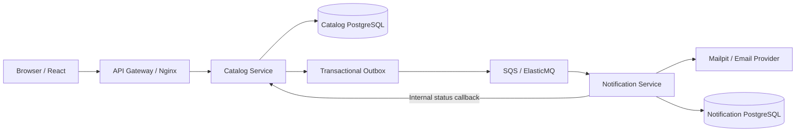

# Catalog Platform — Pull Request

> **Authoring note — remove this note before publishing the PR:** This file is a template. Complete every placeholder using the implementation and verification evidence available at PR creation time. Delete sections that do not apply, but do not delete required disclosure of failed checks, incomplete requirements or known limitations. Never mark a requirement as complete without verifying it.

## PR metadata

- **Title:** `feat: build product catalogue and enquiry workflow`
- **Base branch:** `main`
- **Head branch:** `[feature branch name]`
- **PR number / URL:** `[add after PR creation]`
- **Head commit SHA reviewed:** `[add exact SHA for each review]`
- **PR state:** `[verify that the PR is OPEN and UNMERGED]`

## Summary

[Describe what this pull request actually delivers in 3–6 concise bullets. Focus on the customer journey and the most important engineering work. Do not copy planned scope that was not implemented.]

- [Delivered capability]
- [Delivered capability]
- [Delivered capability]

## Assessment acceptance criteria

Record the result against the five original customer scenarios. Link to a test, screenshot, endpoint response or other reproducible evidence where possible.

| Acceptance criterion | Status | Evidence |
|---|---|---|
| Homepage displays the five selected featured products. | `[PASS / PARTIAL / NOT IMPLEMENTED]` | `[test, screenshot or route]` |
| Selecting a category displays top-rated and additional products in that category. | `[PASS / PARTIAL / NOT IMPLEMENTED]` | `[test, screenshot or route]` |
| Submitting a search term displays only products whose text matches. | `[PASS / PARTIAL / NOT IMPLEMENTED]` | `[test, screenshot or route]` |
| Selecting a product tile opens its product details page. | `[PASS / PARTIAL / NOT IMPLEMENTED]` | `[test, screenshot or route]` |
| Submitting a product enquiry sends an email to the configured sales inbox and displays a Thank You message. | `[PASS / PARTIAL / NOT IMPLEMENTED]` | `[integration test and Mailpit evidence]` |

Do not describe category enquiries as a substitute for the required product enquiry scenario. Record category enquiry support separately if implemented.

## Architecture and implementation

[Summarize the implementation as it exists in this PR. Mention only components and integrations that are present in the code.]

Expected architecture reference (update if the implementation differs):

### Service responsibilities

- **Frontend:** [Describe the implemented pages and customer interactions.]
- **API Gateway:** [Describe the actual local routing and any production mapping documented.]
- **Catalog Service:** [Describe actual catalogue, search, enquiry, persistence, outbox and lifecycle responsibilities.]
- **Notification Service:** [Describe actual queue consumption, delivery ledger, email and callback responsibilities.]
- **Product provider:** [Name the implemented provider and explain the adapter boundary.]
- **Email provider:** [Name the implemented local provider and any production adapter boundary.]

### Reliability and lifecycle behaviour

Describe the verified behaviour for each case. Do not infer that a case works simply because the code path exists.

| Scenario | Actual behaviour | Verification evidence |
|---|---|---|
| Enquiry accepted | `[explain when RECEIVED is persisted and what the customer confirmation means]` | `[test/evidence]` |
| Email provider accepts the message | `[explain delivery-ledger and callback behaviour]` | `[test/evidence]` |
| Email delivery fails | `[explain retry/DLQ handling and enquiry status]` | `[test/evidence]` |
| Catalog callback fails after email acceptance | `[explain durable callback retry and how duplicate email is prevented]` | `[test/evidence]` |
| Duplicate event or callback | `[explain idempotency and lifecycle protection]` | `[test/evidence]` |

## Key decisions and assumptions

[Summarize only the decisions and assumptions that materially shaped this implementation. Explain any accepted simplification or deviation from the approved design.]

Relevant project documents:

- [`DECISIONS.md`](./DECISIONS.md)
- [`ASSUMPTIONS.md`](./ASSUMPTIONS.md)
- [`SPEC.md`](./SPEC.md)
- [`PLAN.md`](./PLAN.md)
- [`CLAUDE.md`](./CLAUDE.md)

**Approved design deviations in this PR:** `[None, or list each deviation and its rationale. Update DECISIONS.md / ASSUMPTIONS.md where required.]`

## Local setup and reviewer instructions

Follow [`README.md`](./README.md) for prerequisites, configuration and the exact startup procedure.

- **Verified startup command(s):** `[copy the exact command(s) that were run successfully from a clean checkout]`
- **Frontend URL:** `[verified URL and port]`
- **Mailpit URL:** `[verified URL and port]`
- **Required local configuration:** `[list required non-secret variables; confirm .env.example is current]`
- **Reviewer setup time:** `[measured or clearly labelled estimate; target is under 10 minutes]`

The local workflow must not require AWS credentials, paid services or accounts that the reviewer must create. Do not commit `.env` files or secrets.

## Tests and verification

Record exact commands, actual outcomes and relevant evidence. Include failures; do not report a check as passing if it was skipped, flaky or not run.

| Verification | Exact command / method | Result | Evidence / notes |
|---|---|---|---|
| Unit tests | `[command]` | `[PASS / FAIL / NOT RUN]` | `[summary or CI link]` |
| Backend API / integration tests | `[command]` | `[PASS / FAIL / NOT RUN]` | `[summary or CI link]` |
| Frontend tests | `[command]` | `[PASS / FAIL / NOT RUN]` | `[summary or CI link]` |
| TypeScript type checking | `[command]` | `[PASS / FAIL / NOT RUN]` | `[summary or CI link]` |
| Lint | `[command]` | `[PASS / FAIL / NOT RUN]` | `[summary or CI link]` |
| Docker Compose clean-start verification | `[exact commands and clean-checkout procedure]` | `[PASS / FAIL / NOT RUN]` | `[startup logs / screenshot]` |
| End-to-end enquiry-to-email flow | `[method]` | `[PASS / FAIL / NOT RUN]` | `[Mailpit/test evidence]` |
| Email-failure behaviour | `[method]` | `[PASS / FAIL / NOT RUN]` | `[test/evidence]` |
| Callback-retry behaviour without email resend | `[method]` | `[PASS / FAIL / NOT RUN]` | `[test/evidence]` |
| Duplicate event / callback handling | `[method]` | `[PASS / FAIL / NOT RUN]` | `[test/evidence]` |

**Overall verification summary:** `[Summarize what passed, failed, was skipped and remains unverified.]`

## Screenshots or recordings

[Add relevant screenshots, short recordings or links that demonstrate the customer-facing pages and enquiry confirmation. Do not include secrets or real customer personal data. Remove this section if no visual evidence is available.]

## Known limitations and deferred work

[List only real limitations that remain in this PR. Include the user or operational impact and, where useful, a likely next step. If there are none, say so only after checking.]

- `[Limitation / deferred requirement — impact — next step]`

Do not hide failed tests, incomplete acceptance criteria, unsupported local-emulator behaviour or unimplemented reliability paths in this section.

## Independent PR review

Complete this section after the reviewer subagent has inspected the actual PR diff. Do not fill it with a self-review or an anticipated result.

- **Reviewer:** `[actual reviewer agent/model identity]`
- **Reviewed PR head SHA:** `[exact SHA]`
- **Review verdict:** `[CHANGES REQUIRED / REVIEW PASSED / NOT YET COMPLETED]`
- **GitHub review/comment link:** `[actual URL]`
- **P0 findings:** `[count and disposition]`
- **P1 findings:** `[count and disposition]`
- **P2 findings:** `[count and disposition]`
- **P3 findings:** `[count and disposition]`
- **Corrections pushed to this PR:** `[list commits/findings or None]`
- **Re-review SHA and result:** `[exact SHA and actual outcome, or Not performed]`

When the author and reviewer use the same GitHub identity, describe the outcome as a review comment/verdict, not a formal GitHub approval. P0 and P1 findings must be resolved before submission; applicable P2 findings must be resolved or explicitly documented.

## Final checklist

- [ ] This PR targets `main` from the assessment feature branch.
- [ ] The PR remains open and unmerged.
- [ ] The five original acceptance criteria have an honest status and evidence.
- [ ] Full source code and tests are included; no secrets are committed.
- [ ] README setup instructions were verified from a clean checkout.
- [ ] Tests, type checking and lint have actual recorded outcomes.
- [ ] Known limitations and deferred work are disclosed.
- [ ] `AI_USAGE.md` and `TIME_SPENT.md` reflect actual work.
- [ ] The independent reviewer has published a verdict on this PR, or the review is explicitly recorded as incomplete.
- [ ] Review corrections are pushed to this same PR and affected checks have been rerun.

---

**Submission note:** The assessment requires the repository link and an open, unmerged feature-branch PR. This description is part of the assessment; keep it accurate, concise and defensible in the follow-up interview.
