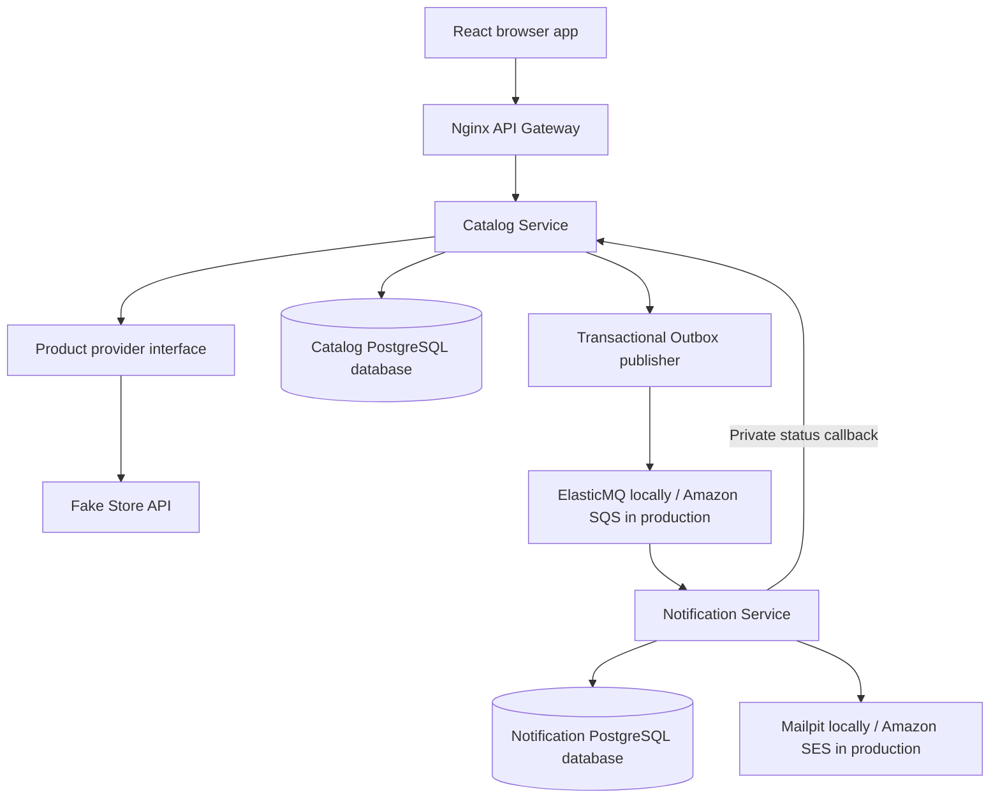

# Catalog Platform

A responsive product catalogue with product discovery, search, product details and customer enquiries. The application is designed as a small proof of concept with replaceable product and email providers, a locally runnable workflow and an AWS-compatible target architecture.

> **Documentation status:** Updated to match the implemented and verified system (2026-11-22). Commands, ports and test results below were run during implementation; see *Testing and verification* and `TIME_SPENT.md`.

## Delivery status

Implementation is delivered as sequential pull requests into `main` (see `DECISIONS.md`, ADR-017):

| PR | Branch | Scope | Status |
|---|---|---|---|
| 1 | `chore/setup` | pnpm workspace, TypeScript/ESLint, shared contracts, PostgreSQL/ElasticMQ/Mailpit | Merged (#1) |
| 2 | `feat/catalog-service` | Catalogue APIs, enquiries, Transactional Outbox, internal callback, CI | Merged (#2) |
| 3 | `feat/notification-service` | SQS consumer, ledger, templates, email, callback retry, Circuit Breaker | Merged (#7) |
| 4 | `feat/frontend-gateway` | React app and Nginx API Gateway | In review (#9) |
| 5 | `test/e2e-docs` | End-to-end verification and final documentation | Open (submission PR) |

Current runnable state (after PR 4): the complete application.

```bash
cp .env.example .env
docker compose up --build      # first build takes a few minutes; then open http://localhost:8080
```

Submit an enquiry from a product or category page, then open http://localhost:8025 to see the sales email; the enquiry moves to `PROCESSED` once Notification Service's callback is persisted. Set `PRODUCT_PROVIDER=fixture` in `.env` to run fully offline. Requires Docker Compose v2.20+.

## Assessment scope

The initial customer experience covers:

- A homepage showing five backend-configured featured products.
- Category browsing with top-rated and additional products.
- Text-based product search.
- Product details.
- A product enquiry form that durably accepts the enquiry, starts asynchronous sales email notification and shows the customer a Thank You/received confirmation.

Category enquiries are supported as an extension of the same enquiry model and workflow. The original product enquiry journey remains the critical assessment path.

## Technology choices

The assessment asks for one client and one backend from its permitted options. This project chooses:

| Layer | Choice | Reason |
|---|---|---|
| Client | React + TypeScript | A component-based web UI with strong typing and a straightforward local build. |
| Backend | Node.js + TypeScript + Express | A TypeScript backend that shares types and validation contracts with the frontend ecosystem. |
| Frontend tooling | Vite | Fast local development and static production build. |
| Package manager | pnpm | Consistent dependency management across the workspace. |
| API validation | Zod | Runtime validation at application boundaries. |
| Persistence | PostgreSQL | Durable enquiry, outbox and notification delivery records. |
| Messaging | AWS SQS Standard Queue; ElasticMQ locally | AWS-compatible asynchronous messaging without requiring an AWS account for local review. |
| Local email | Mailpit | Captures test emails locally without a paid email account or sending real email. |
| Production email target | Amazon SES | Replaceable production email-provider adapter. |
| Local API gateway | Nginx | Serves the frontend and proxies browser API requests to Catalog Service. |
| Local execution | Docker Compose | Runs the complete core workflow through a reproducible local environment. |

The initial product data source is Fake Store API. It is accessed only by Catalog Service through a provider abstraction; the browser must never call it directly.

## Architecture

There are exactly two business microservices: **Catalog Service** and **Notification Service**. The browser communicates with backend APIs only through the API Gateway. Notification Service is a private worker and is not exposed through the public frontend API.



### Service ownership

**Catalog Service** owns product access and normalization, featured-product selection, category browsing, search, product details, enquiry creation and persistence, enquiry lifecycle status, the Transactional Outbox, SQS publishing and the private notification-status callback API.

**Notification Service** owns SQS consumption, notification processing, email templates and provider integration, the notification delivery ledger, idempotency, callback retry state and the Circuit Breaker for Catalog Service communication.

Each service owns its data. Notification Service must never read or write Catalog Service database tables directly. For local development, a PostgreSQL container may host separate logical databases with separate credentials and migrations.

### Enquiry lifecycle

The enquiry's business status is owned exclusively by Catalog Service:

```text
RECEIVED → PROCESSED → RESOLVED
```

1. Catalog Service validates the customer and product/category reference, then commits the enquiry and its Outbox event in one database transaction.
2. The API returns `202 Accepted` only after that transaction commits. The response means the enquiry has been durably received; it does not mean the email has already been sent.
3. The Outbox publisher publishes the event to SQS. Notification Service consumes it and records processing in its own delivery ledger.
4. After the configured email provider accepts the message, Notification Service durably records the send result and attempts the private Catalog Service callback.
5. Catalog Service moves the enquiry to `PROCESSED` only after it successfully validates and persists the callback.
6. `RESOLVED` is a later explicit business action. Email delivery does not resolve an enquiry.

If email sending fails, the enquiry remains `RECEIVED`. If email sending succeeds but the callback fails, the callback is retried durably without sending the email again. Provider acceptance does not guarantee delivery to the recipient's inbox.

## Local setup

The required reviewer experience is a clean local run in under 10 minutes, without an AWS account, AWS credentials, paid services or an external email account.

### Prerequisites

- Git.
- Docker with Docker Compose v2.
- An internet connection if using Fake Store API as the active local product provider.

Node.js and pnpm are needed only for host-based development or running workspace commands outside the containers: Node.js 22 or later (`engines` in `package.json`) and pnpm 10.17 (`packageManager` in `package.json`; `corepack enable` selects it).

### Start the application

Clone the repository and change into its directory, then run the following two setup commands from the repository root:

```bash
cp .env.example .env
docker compose up --build
```

Verified: GitHub Actions' *Docker Compose smoke test* and *End-to-end* jobs run exactly these commands on a fresh checkout for every PR. Migrations run as one-shot `catalog-migrate` / `notification-migrate` jobs, ElasticMQ creates the queue and DLQ from `infra/elasticmq/elasticmq.conf`, services wait for their dependencies, and the gateway becomes healthy once Catalog is ready. The first build takes a few minutes; later starts take seconds.

### Local URLs

| Component | URL | Status |
|---|---|---|
| Catalogue web application + API Gateway | http://localhost:8080 | Nginx serves the React build and routes `/api/catalog/*` to Catalog Service (`GATEWAY_PORT`) |
| Public API (through the Gateway) | http://localhost:8080/api/catalog/products/featured | Only `/api/catalog/*` is routed; `/internal/*`, `/health/*` and other `/api/*` return 404 |
| Mailpit web interface (captured sales emails) | http://localhost:8025 | Bound to 127.0.0.1 only (`MAILPIT_UI_PORT`) |
| Catalog / Notification health | not published | Container health checks only (`docker compose ps`) |

The browser should use the same-origin API path `/api/catalog`; it should not need internal service hostnames or ports.

### Stop and inspect the environment

Run from the repository root:

```bash
# Stop and remove the containers and network; retain named database volumes.
docker compose down

# Inspect running services.
docker compose ps

# Follow service logs.
docker compose logs -f
```

To delete local database/queue volumes and reset local state, use `docker compose down -v`. **This is destructive:** it removes persisted local development data.

Database roles and passwords are created only when the PostgreSQL volume is first initialised. If you change `CATALOG_DB_PASSWORD` or `NOTIFICATION_DB_PASSWORD` in `.env` afterwards, run `docker compose down -v` to re-initialise local data.

## Configuration

`.env.example` is the committed reference for local configuration. Copy it to `.env` and provide only local values. Never commit `.env`, passwords, tokens, API keys, production credentials or other secrets.

| Variable (`.env`) | Purpose | Local value |
|---|---|---|
| `POSTGRES_ADMIN_PASSWORD` | PostgreSQL superuser (container init and test-only access) | `local-admin-password` |
| `CATALOG_DB_PASSWORD` / `NOTIFICATION_DB_PASSWORD` | Separate service roles `catalog_svc` / `notification_svc` | local placeholders |
| `PRODUCT_PROVIDER` | `fakestore` (live Fake Store API) or `fixture` (offline snapshot) | `fakestore` |
| `FEATURED_PRODUCT_IDS` | Exactly five distinct product IDs for the homepage (validated at startup) | `1,5,9,12,18` |
| `ENQUIRY_RATE_LIMIT_PER_MINUTE` | Per-IP public enquiry rate limit | `10` |
| `INTERNAL_API_TOKEN` | Bearer token for the internal Catalog callback (minimum 16 characters) | local placeholder |
| `EMAIL_FROM`, `SALES_RECIPIENT_PRODUCT`, `SALES_RECIPIENT_CATEGORY` | Trusted, server-side email routing | `@example.com` addresses (captured by Mailpit) |
| `GATEWAY_PORT`, `MAILPIT_UI_PORT`, `POSTGRES_HOST_PORT`, `SQS_HOST_PORT` | Host ports (Postgres/SQS/Mailpit bound to 127.0.0.1) | `8080`, `8025`, `55432`, `59324` |
| `LOG_LEVEL` | pino log level | `info` |

Each service validates its full configuration with Zod at startup and fails fast on invalid values (`services/*/src/config.ts`). Tuning variables have safe defaults and are optional: outbox polling and lease, SQS wait/visibility/max-receive, email send timeout, callback timeout/backoff/max attempts, and the circuit breaker threshold/open duration/probes. The SQS endpoint, SMTP host and internal URLs are set in `docker-compose.yml`.

Expected configuration areas include:

- Catalog and Notification Service database connection settings.
- Local SQS-compatible endpoint, queue names and AWS region settings needed by the AWS SDK v3.
- Mailpit SMTP host and port.
- Trusted sales inbox configuration.
- Product provider selection and optional fixture mode.
- Public API base path and local service ports.

No AWS credentials should be required for the default local workflow. Production AWS access should use the appropriate IAM task roles and managed secret configuration, not credentials committed to this repository.

## Product and API behaviour

All browser requests go through the API Gateway under `/api/catalog`. The following is the approved initial public API surface; update the exact query parameter names, request/response schemas and error formats from `docs/openapi.yaml` and `docs/api-contracts.md` after those contracts are implemented.

| Method | Path | Purpose |
|---|---|---|
| `GET` | `/api/catalog/products/featured` | Return the five backend-configured featured products. |
| `GET` | `/api/catalog/products` | List products and support text search. |
| `GET` | `/api/catalog/products/:productId` | Return normalized details for one product. |
| `GET` | `/api/catalog/categories` | Return available categories. |
| `GET` | `/api/catalog/categories/:categoryId/products` | Return top-rated and additional products for a category. |
| `POST` | `/api/catalog/enquiries` | Create a product or category enquiry. |

The Notification Service callback is an internal service-to-service operation, not a public browser endpoint:

```text
PATCH /internal/catalog/enquiries/:enquiryId/notification-status
```

### Enquiry request

The initial request shape is:

```json
{
  "entity": {
    "type": "PRODUCT",
    "id": "101"
  },
  "customer": {
    "name": "John Doe",
    "email": "john@example.com",
    "phone": "+919876543210"
  },
  "message": "Please share more details."
}
```

`entity.type` is `PRODUCT` or `CATEGORY`. Name, email and phone are required; message is optional. The backend resolves the sales recipient from trusted server-side configuration. The frontend must not supply an arbitrary recipient address.

A successful enquiry submission returns `202 Accepted` after durable persistence. The customer-facing confirmation should say the enquiry was received, not claim that the sales email has already reached the inbox.

## Continuous integration

GitHub Actions run on every pull request to `main` and on pushes to `main`:

| Workflow | Job | What it proves |
|---|---|---|
| `ci.yml` | Typecheck, lint and unit tests | `pnpm install --frozen-lockfile`, `pnpm typecheck`, `pnpm lint`, `pnpm test`, `pnpm build` |
| `ci.yml` | Integration tests | `pnpm test:integration` against PostgreSQL 17 and ElasticMQ service containers (outbox atomicity, claim/lease, SQS publish, callback idempotency) |
| `ci.yml` | Docker Compose smoke test | Builds images, runs migrations via the one-shot job, waits for health, checks featured/category APIs and that an enquiry's outbox event is published to ElasticMQ (offline `fixture` provider) |
| `codeql.yml` | CodeQL | `security-and-quality` static analysis for JavaScript/TypeScript (also weekly) |

Dependabot (`.github/dependabot.yml`) proposes weekly npm, GitHub Actions and Docker base-image updates.

**Continuous delivery is not automated.** Deploying to AWS (push images to ECR, update ECS Fargate services, sync the frontend to S3/CloudFront) needs an AWS account and a GitHub OIDC deploy role, which are outside the assessment's local-only scope (ADR-016). The intended pipeline is documented in `docs/deployment.md`; adding it is future work.

## Testing and verification

Tests should cover the critical customer journey and important failure scenarios, not just isolated happy paths.

Expected coverage includes:

- Featured product selection and product-provider normalization.
- Category ranking, deterministic tie-breaking and exclusion of duplicates between top-rated and additional products.
- Search matching and empty/whitespace query validation.
- Product detail handling for missing products and provider failures.
- Enquiry validation and atomic enquiry-plus-Outbox persistence.
- SQS event validation, duplicate delivery and consumer idempotency.
- Email template rendering and escaping of customer-provided content.
- Email failure leaving the enquiry in `RECEIVED`.
- Callback retry after email success without resending the email.
- Duplicate/stale callbacks and protection against regressing `RESOLVED`.
- Critical frontend states and the end-to-end enquiry-to-email journey.

### Commands

Run from the repository root after `pnpm install` (Node 22+, pnpm 10.17):

| Command | What it runs | Needs |
|---|---|---|
| `pnpm typecheck` | `tsc --noEmit` for contracts, both services, web and E2E (strict mode) | — |
| `pnpm lint` | ESLint (typescript-eslint, `no-explicit-any` as error) | — |
| `pnpm test` | Unit/API tests: contracts, Catalog (Supertest, fixture provider), Notification, web (React Testing Library) | — |
| `pnpm test:integration` | Catalog + Notification against real PostgreSQL and ElasticMQ (isolated `*_it` databases, temporary queues) | `docker compose up -d postgres elasticmq` |
| `pnpm test:e2e` | Playwright against the full stack through the gateway; checks Mailpit and both databases | `docker compose up -d --build` (`pnpm exec playwright install chromium` once) |

### Results on the final commit

| Suite | Tests |
|---|---|
| Contracts (unit) | 23 |
| Catalog Service (unit/API) | 45 |
| Catalog Service (integration) | 18 |
| Notification Service (unit) | 24 |
| Notification Service (integration) | 16 |
| Web (React Testing Library) | 14 |
| End-to-end (Playwright, desktop + mobile Chromium) | 5 |

All of these pass locally, and GitHub Actions runs them on every PR (see *Continuous integration*). The integration and E2E tests cover the failure paths: email failure leaves the enquiry `RECEIVED`, retry exhaustion redrives to the DLQ, a callback failure is retried without resending the email (including after a simulated restart), the circuit breaker behaves correctly in all three states, duplicate and concurrent deliveries are handled, and `RESOLVED` is never regressed.

## Production architecture target

The local setup is designed to use AWS-compatible service interfaces. The production target maps the local components as follows:

| Local component | AWS production target |
|---|---|
| Static React build served by Nginx | Amazon S3 + CloudFront |
| Nginx public API proxy | Amazon API Gateway HTTP API; CloudFront routes API paths to API Gateway |
| Catalog Service container | Amazon ECS Fargate |
| Notification Service worker container | Amazon ECS Fargate |
| PostgreSQL | Amazon RDS for PostgreSQL, preserving service data ownership |
| ElasticMQ | Amazon SQS Standard Queue and Dead Letter Queue |
| Mailpit | Amazon SES |
| Local environment configuration | IAM task roles and AWS Secrets Manager where appropriate |

Full production AWS provisioning is not part of the initial assessment scope. ElasticMQ is an SQS-compatible local implementation, not a complete emulator of every AWS SQS-managed behaviour. Local testing demonstrates the application integration with the subset used; it does not prove every production AWS service characteristic.

## Scope and known limitations

The initial scope intentionally excludes:

- Shopping cart, checkout, payment processing and inventory management.
- Customer accounts and general customer authentication.
- A sales dashboard or CRM integration.
- Enquiry entity types other than `PRODUCT` and `CATEGORY`.
- Multi-tenancy, SNS fan-out and additional business microservices.
- Kafka, RabbitMQ, BullMQ, Redis, Kubernetes and EKS.
- Full production AWS provisioning.
- SES bounce/delivery-event integration; provider acceptance is the initial success signal.

`RESOLVED` is represented in the domain and transition rules, but a complete authenticated sales-management interface is deferred. The exact implemented limitations must be reviewed and updated before submission.

## Project documentation

| Document | Purpose |
|---|---|
| [`CLAUDE.md`](./CLAUDE.md) | Engineering instructions, guardrails and implementation workflow. |
| [`SPEC.md`](./SPEC.md) | Product and technical specification. |
| [`PLAN.md`](./PLAN.md) | Implementation phases, targets and verification gates. |
| [`ASSUMPTIONS.md`](./ASSUMPTIONS.md) | Ambiguities, accepted assumptions and validation approach. |
| [`DECISIONS.md`](./DECISIONS.md) | Architecture decisions, alternatives, rationale and consequences. |
| [`AI_USAGE.md`](./AI_USAGE.md) | Actual AI tools/models, key prompts or moments, mistakes and corrections. |
| [`TIME_SPENT.md`](./TIME_SPENT.md) | Actual measured time across planning, building, testing and reviewing. |
| `PR_DESCRIPTION.md` | Pull Request summary, test evidence and known limitations (created for the submission). |
| `docs/openapi.yaml` | Machine-readable API contract (to be added/verified with implementation). |
| `docs/api-contracts.md` | API request/response and error contract details (to be added/verified with implementation). |

## Assessment submission checklist

Before sending the repository to the reviewer:

- [ ] Replace all `VERIFY AFTER IMPLEMENTATION` markers with accurate, tested details.
- [ ] Verify the application starts from a clean checkout in under 10 minutes using the documented commands.
- [ ] Confirm the five original customer acceptance scenarios are demonstrable.
- [ ] Confirm Fake Store API is called only by Catalog Service.
- [ ] Confirm the full product enquiry journey, including the email in Mailpit, works locally.
- [ ] Verify email failure and callback-retry behaviour; do not resend a successfully accepted email because of a callback failure.
- [ ] Include source code and tests; do not commit secrets.
- [ ] Update this README with actual ports, environment variables, test commands and remaining limitations.
- [ ] Complete `AI_USAGE.md` and `TIME_SPENT.md` using actual evidence; do not fabricate tool usage, mistakes, test results, review outcomes or durations.
- [ ] Push each feature branch and open its PR targeting `main` (sequential PRs, ADR-017).
- [ ] Leave the PR open and unmerged.
- [ ] Record the actual independent PR review verdict and reviewed commit SHA; do not claim review completion before it occurs.

## Further work

For the significant design trade-offs, deferred work and next steps with additional time, see [`DECISIONS.md`](./DECISIONS.md). The implementation plan and exit gates are in [`PLAN.md`](./PLAN.md).
