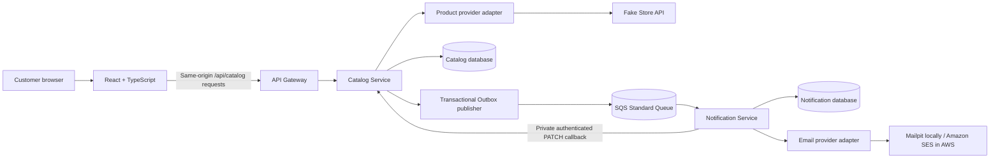
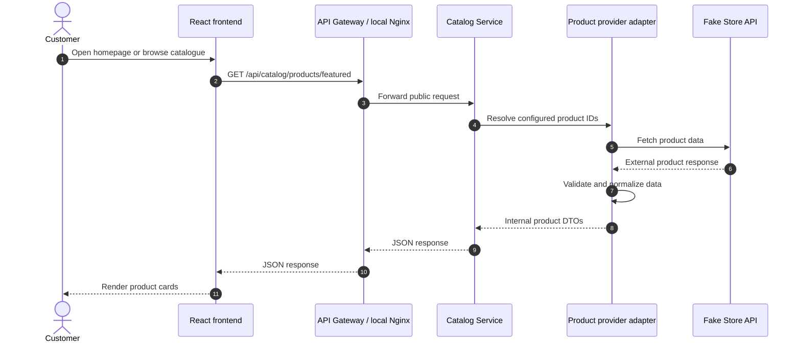
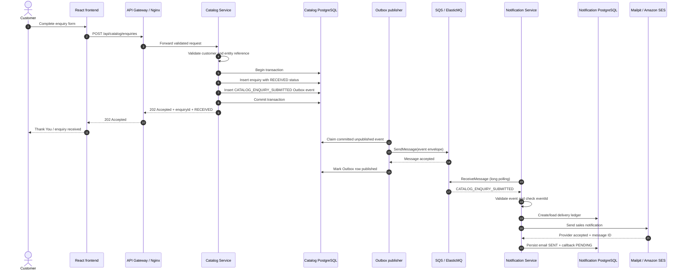
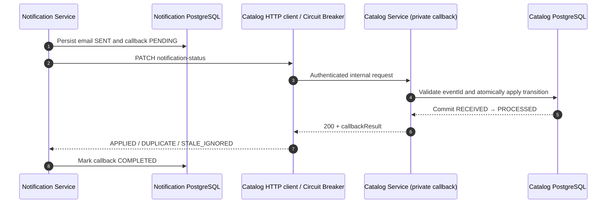
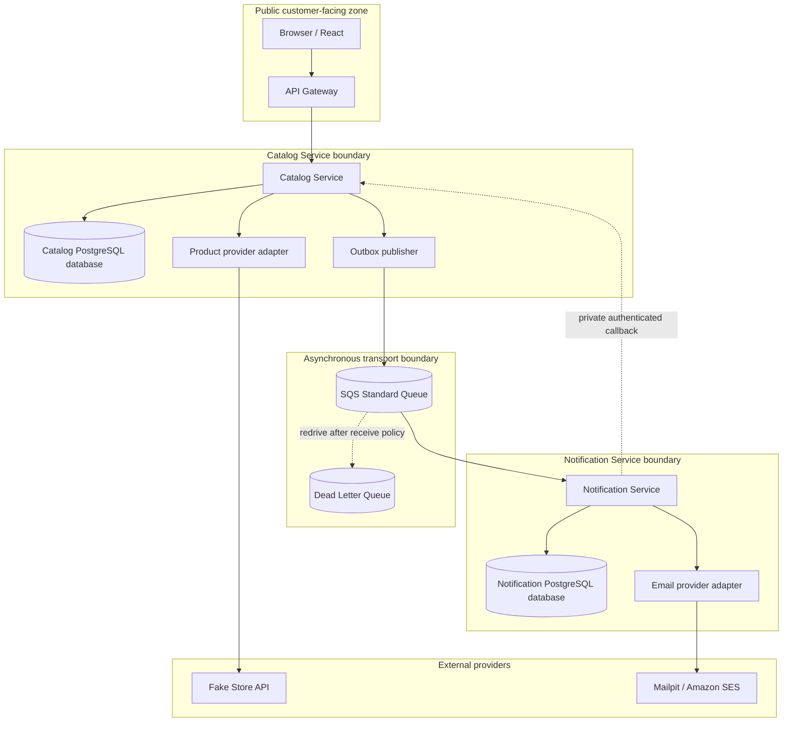
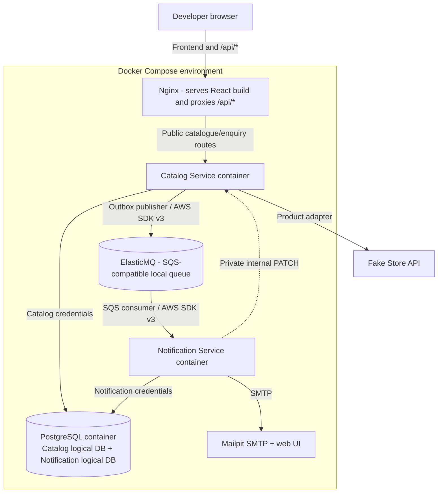
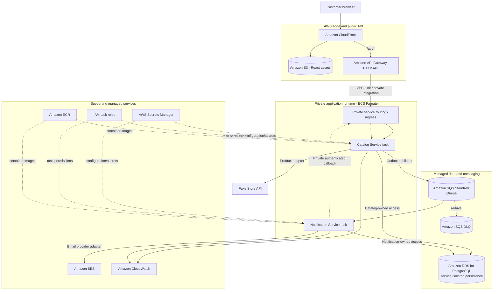

# Catalog Platform — Architecture

**Version:** 1.0  
**Status:** Approved architecture baseline; verify against the implemented system before submission  
**Project:** AI-Native Engineer Code Challenge for Catalog Platform 
**Architecture style:** React web application, API Gateway and two business microservices with asynchronous notification processing  
**Related documents:** `CLAUDE.md`, `SPEC.md`, `ASSUMPTIONS.md`, `DECISIONS.md`, `PLAN.md`, `README.md`, `docs/api-contracts.md`, `docs/openapi.yaml`, `docs/event-contracts.md`, `docs/data-model.md`

---

## 1. Purpose

This document provides a system-level view of the Catalog Platform. It describes the major components, service boundaries, public request path, asynchronous enquiry-to-email workflow, callback recovery path, data ownership and local-to-AWS deployment mapping.

It is a visual companion to the detailed contracts. It does not replace:

- `SPEC.md` for functional and non-functional requirements.
- `docs/api-contracts.md` and `docs/openapi.yaml` for HTTP contracts.
- `docs/event-contracts.md` for the SQS event and delivery semantics.
- `docs/data-model.md` for persistence schemas and transaction boundaries.
- `DECISIONS.md` for the rationale and trade-offs behind the selected architecture.

The diagrams show the approved target design. They are not proof that the corresponding implementation or infrastructure has already been built or deployed. Before submission, compare them with the actual source code, Docker Compose topology and verified runtime behaviour.

## 2. Architecture at a Glance

The system has one customer-facing React application, one API Gateway and exactly two business microservices:

1. **Catalog Service** — owns the product catalogue integration, enquiries, enquiry lifecycle, Outbox and internal notification-status callback.
2. **Notification Service** — consumes enquiry events, sends sales email notifications, and owns notification delivery and callback-retry state.

Catalog Service is the sole authority for enquiry business status. Notification Service never reads or writes Catalog Service database tables. The browser does not call Fake Store API, SQS or Notification Service directly.

The diagram is logical rather than a deployment topology. In local development, the Gateway is Nginx, the queue is ElasticMQ and the email sink is Mailpit. In the AWS target architecture, the Gateway path uses CloudFront/API Gateway, the queue is Amazon SQS and email is sent through Amazon SES.

## 3. Components and Responsibilities

| Component | Responsibility | Must not own or do |
|---|---|---|
| React frontend | Render homepage, categories, search, product details and enquiry form; call public API. | Call Fake Store API, internal service URLs, SQS or Notification Service directly. |
| API Gateway | Single browser-to-backend entry point; route `/api/*` requests to Catalog Service. | Expose Notification Service or the private callback. |
| Catalog Service | Normalize product data; resolve featured products/categories/search/details; validate and persist enquiries; manage business lifecycle; write Outbox; publish event; receive authenticated internal callback. | Own email delivery attempts or Notification Service's callback retry ledger. |
| Product provider adapter | Isolate Fake Store API and normalize/validate upstream product data. | Leak provider-specific data structures into frontend or business contracts. |
| Catalog PostgreSQL store | Persist enquiries, Outbox, callback idempotency and any justified Catalog-owned configuration. | Store Notification Service email/callback delivery status. |
| Outbox publisher | Claim committed unpublished events and publish using AWS SDK for JavaScript v3. | Mark an event published before SQS confirms acceptance. |
| SQS-compatible queue | Buffer asynchronous `CATALOG_ENQUIRY_SUBMITTED` events. | Provide exactly-once delivery or a guaranteed global message order. |
| Notification Service | Validate and consume events; deduplicate; select/render templates; send email; persist delivery outcome; call Catalog; retry callbacks. | Query or update Catalog Service database directly, or own enquiry business status. |
| Notification PostgreSQL store | Persist delivery idempotency, provider outcome and durable callback retry progress. | Become a shared database used by Catalog Service. |
| Email provider adapter | Provide one application-level email interface for local Mailpit SMTP and the AWS SES target. | Accept customer-controlled recipients or let provider-specific code leak into notification business logic. |

There is no separate Enquiry Service, Customer Service, sales dashboard service or additional business microservice in the initial scope.

## 4. Public Catalogue Request Flow

The browser accesses all catalogue and enquiry endpoints through the same API Gateway path. In local mode, Nginx serves the React build and proxies `/api/*` requests to Catalog Service. The Catalog Service uses the product-provider abstraction for external product data.

The same public path supports:

| Customer action | Public API operation |
|---|---|
| Load featured products | `GET /api/catalog/products/featured` |
| List products or search | `GET /api/catalog/products` |
| View product details | `GET /api/catalog/products/{productId}` |
| List categories | `GET /api/catalog/categories` |
| Browse a category | `GET /api/catalog/categories/{categoryId}/products` |
| Submit a product/category enquiry | `POST /api/catalog/enquiries` |

The authoritative path and schema for each operation are defined in `docs/api-contracts.md` and `docs/openapi.yaml`.

### 4.1 Product data boundary

Fake Store API is the initial upstream source. It is accessed only by the Catalog Service adapter. The adapter validates upstream data and converts it into the platform's normalized product DTO before the service returns data to the browser.

The initial design does not persist a duplicate product catalogue. Enquiry records do retain a snapshot of the referenced product or category so the enquiry keeps the context available at submission time. Product merchandising configuration may be stored or supplied through Catalog-owned configuration; it must not be hardcoded into React components.

### 4.2 Public response behaviour

- Catalogue read endpoints return normalized DTOs.
- Search is performed by Catalog Service and returns only matching products.
- Provider errors must be surfaced as appropriate errors rather than silently converted into successful empty results.
- The browser must not depend on internal service hostnames or ports.

## 5. Enquiry Acceptance and Asynchronous Notification Flow

Submitting an enquiry is a two-stage operation: Catalog Service durably accepts the enquiry synchronously, then Notification Service processes the resulting event asynchronously.

### 5.1 Durable acceptance rule

Catalog Service must commit the enquiry and its Outbox event in one PostgreSQL transaction. It returns `202 Accepted` only after that transaction commits. This response means the platform has durably received the enquiry; it does not mean the sales email has been sent or delivered.

If the transaction fails, the API must not return a successful acceptance response. If SQS is temporarily unavailable after the transaction commits, the Outbox row remains available for publisher retry and the already accepted enquiry remains durable.

### 5.2 Event publication rule

The Outbox publisher claims committed unpublished rows and publishes the versioned event to the configured SQS queue using AWS SDK v3. It records successful publication only after SQS accepts the message.

A publisher crash after SQS accepts the message but before the database records publication can cause the same event to be published again. This is expected; the stable `eventId` and Notification Service delivery ledger mitigate duplicate processing.

### 5.3 Notification delivery rule

Notification Service validates the event, checks its delivery ledger by `eventId`, resolves a trusted server-side sales recipient and selects the PRODUCT or CATEGORY template. It sends through the configured email provider and durably records the provider outcome and message ID.

The email provider's successful response means the provider accepted the send request. It is not proof that the recipient's inbox received the email.

## 6. Callback and Recovery Flow

After provider acceptance, Notification Service persists the callback as pending and calls Catalog Service through a private, authenticated internal HTTP endpoint. Catalog Service validates the event identity and is the only service allowed to persist the business lifecycle transition.

The callback route is:

`PATCH /internal/catalog/enquiries/{enquiryId}/notification-status`

It is not a public frontend API and must not be exposed through the customer-facing API Gateway route.

### 6.1 Business lifecycle ownership

The only normal enquiry lifecycle is:

`RECEIVED → PROCESSED → RESOLVED`

| Situation | Catalog enquiry status |
|---|---|
| Enquiry and Outbox transaction committed | `RECEIVED` |
| Event published or consumed | `RECEIVED` |
| Email attempt failed or is retrying | `RECEIVED` |
| Email retry exhausted / message sent to DLQ | `RECEIVED` |
| Email provider accepted; callback is pending | `RECEIVED` |
| Catalog Service persisted successful callback | `PROCESSED` |
| Sales explicitly resolves enquiry | `RESOLVED` |

`RESOLVED` is an explicit business action. Email delivery must never resolve an enquiry automatically. The initial assessment does not include a sales dashboard or an unauthenticated public resolution endpoint.

### 6.2 Callback success outcomes

Catalog Service may return one of three safe outcomes:

- `APPLIED` — the transition to `PROCESSED` was persisted.
- `DUPLICATE` — the callback event was already handled safely.
- `STALE_IGNORED` — the enquiry was already `RESOLVED`; no regression occurred.

Notification Service may mark the callback complete for any of these safe outcomes.

### 6.3 Email failure

When the email provider reports a failed send:

1. Notification Service records the failed delivery attempt.
2. It does not call the successful notification callback.
3. The Catalog enquiry remains `RECEIVED`.
4. The SQS message follows the configured retry/redrive policy.
5. If receive attempts are exhausted, the message is moved to the DLQ and remains inspectable for controlled recovery.

### 6.4 Callback failure after email success

When email has succeeded but the Catalog callback fails or Catalog Service is unavailable:

1. Keep `email_status = SENT`.
2. Keep `callback_status = PENDING`.
3. Preserve the provider message ID.
4. Do not send the email again solely because the callback failed.
5. Retry the callback through durable Notification Service state and exponential backoff with jitter.
6. Use the Circuit Breaker around the Catalog Service HTTP dependency.
7. Keep the Catalog enquiry `RECEIVED` until Catalog Service confirms the persisted transition.

The callback retry process must survive Notification Service restarts. The original SQS message may be acknowledged once the successful email outcome and pending callback retry state are durably stored; callback retry then proceeds independently.

### 6.5 Delivery guarantees and residual risk

SQS Standard Queue provides at-least-once delivery and does not guarantee global ordering. The consumer must be idempotent. The system must not claim exactly-once event processing or email delivery.

A provider/network failure can leave an uncertain send outcome—for example, the provider may have accepted a message immediately before the Notification Service lost the response or crashed before storing the outcome. This residual ambiguity must be documented; it must not be presented as a guaranteed exactly-once workflow.

## 7. Data Ownership and Trust Boundaries

The dashed callback is an internal service-to-service HTTP call, not a new public API route. The SQS source queue and DLQ are transport infrastructure, not business microservices.

### 7.1 Catalog Service data ownership

Catalog Service owns:

- `catalog_enquiries` and enquiry business status.
- `outbox_events` and event publication state.
- Processed callback event IDs or an equivalent idempotency record.
- Catalog-owned merchandising configuration where persisted.

### 7.2 Notification Service data ownership

Notification Service owns:

- `notification_deliveries` or an equivalent durable delivery ledger.
- Email attempt and provider outcome information.
- Callback completion and retry progress.
- Notification processing idempotency keyed by the originating `eventId`.

The two services may use separate logical databases in one local PostgreSQL container for reviewer convenience, but they must use separate credentials and migrations. The production architecture must preserve independent service ownership. No cross-service SQL queries or joins are permitted.

## 8. Deployment Views

### 8.1 Local development topology

The local topology is designed to run through Docker Compose without AWS credentials, a paid service or an external email account.

Local service responsibilities:

| Capability | Local component |
|---|---|
| Browser frontend delivery and public API proxy | Nginx |
| Catalogue and enquiry business logic | Catalog Service container |
| Event consumer, email workflow and callback retries | Notification Service container |
| Catalog data and Outbox | Catalog logical PostgreSQL database |
| Notification ledger and callback retry state | Notification logical PostgreSQL database |
| SQS-compatible messaging | ElasticMQ |
| Email capture and inspection | Mailpit |
| Initial product metadata | Fake Store API through Catalog Service adapter |

A single PostgreSQL container may host the two logical databases locally, but separate service credentials and migration ownership are required. Nginx must not proxy public browser traffic to Notification Service. The Notification-to-Catalog callback uses the internal Compose network address and authenticated internal contract.

### 8.2 AWS production target

The production view maps local responsibilities to AWS-managed services. Full AWS provisioning is not required for the initial assessment; this diagram documents the intended compatibility target.

The diagram is a target mapping, not a deployment recipe. In particular, the exact private routing/ingress mechanism must be selected and configured when infrastructure is implemented. The internal callback must remain private and must not be routed through the customer-facing public API path. Do not infer that a VPC Link alone defines every internal service-to-service networking detail.

| Local capability | AWS target |
|---|---|
| Nginx static delivery | Amazon S3 + CloudFront |
| Nginx public API proxy | Amazon API Gateway HTTP API, integrated to private Catalog Service routing |
| Catalog Service container | Amazon ECS Fargate task |
| Notification Service worker container | Amazon ECS Fargate task |
| PostgreSQL container | Amazon RDS for PostgreSQL, preserving service-owned database/schema boundaries and credentials |
| ElasticMQ | Amazon SQS Standard Queue |
| Local failed-message handling | Amazon SQS DLQ and redrive policy |
| Mailpit | Amazon SES |
| Local environment configuration | AWS Secrets Manager for secrets and environment configuration as appropriate |
| Local service permissions | IAM task roles |
| Container build artefacts | Amazon ECR |
| Container logs and metrics | Amazon CloudWatch |

### 8.3 AWS compatibility boundary

The application should use AWS SDK v3 and provider/transport abstractions so that local and AWS integrations share the same application-level contracts. Local emulators are not exact replicas of AWS-managed services. Passing local tests does not prove every production AWS configuration, networking, IAM policy, quota or managed-service behaviour.

## 9. Cross-Cutting Concerns

### 9.1 Security

- Validate public API input and external provider responses.
- Use parameterized SQL access.
- Resolve sales recipients from trusted server-side configuration.
- Rate-limit public enquiry submission.
- Keep databases, queues and worker-only endpoints private.
- Authenticate the internal Notification-to-Catalog callback.
- Do not treat `eventId` or `correlationId` as authentication.
- Do not commit credentials or secrets.
- Do not log full customer or email payloads.

### 9.2 Observability

Propagate `X-Correlation-ID` from the public request through Catalog Service, the Outbox event, SQS, Notification Service and the internal callback where available.

Useful diagnostic identifiers include:

- `correlationId`.
- `enquiryId`.
- `eventId`.
- Notification delivery record ID.
- Service name and operation.
- Retry attempt and processing duration.

Logs must be structured and must not contain unnecessary customer personal information, email bodies, credentials or provider secrets.

### 9.3 Reliability

- Use the Transactional Outbox for enquiry/event atomicity.
- Expect SQS at-least-once delivery and possible duplicates.
- Use stable event IDs and durable consumer idempotency.
- Acknowledge SQS messages only after required outcomes or retry state are durable.
- Separate email delivery retries from callback retries.
- Use exponential backoff with jitter for retries.
- Protect the Catalog callback HTTP dependency with a Circuit Breaker.
- Keep DLQ messages inspectable and provide a controlled recovery/redrive procedure.

## 10. Architecture Constraints and Non-Goals

The initial assessment implementation does not include:

- A separate Enquiry Service or Customer Service.
- A public Notification Service API.
- A public enquiry status-update or sales-resolution API.
- A sales dashboard or sales-user authentication workflow.
- Shopping cart, checkout, payments or inventory management.
- Additional enquiry entity types beyond `PRODUCT` and `CATEGORY`.
- SNS fan-out, Kafka, RabbitMQ, BullMQ or Redis.
- Kubernetes or EKS.
- Full production AWS provisioning or Terraform implementation unless separately approved.

Do not add infrastructure or business components simply to make the architecture diagram more elaborate. Any deliberate architecture change must be recorded in `ASSUMPTIONS.md` and/or `DECISIONS.md`, then reflected in this document and the relevant contracts.

## 11. Architecture Verification Checklist

This checklist is a verification plan, not proof that implementation has passed.

- [ ] The repository contains exactly two business microservices: Catalog Service and Notification Service.
- [ ] React sends every backend request through the API Gateway.
- [ ] Browser code contains no direct Fake Store API calls or internal service URLs.
- [ ] Catalog Service owns normalized catalogue access and all enquiry business status.
- [ ] Product provider adapter validates and normalizes external data.
- [ ] Enquiry and Outbox event commit in one Catalog database transaction.
- [ ] Outbox publisher marks publication only after SQS acceptance.
- [ ] Notification Service consumes the versioned event and uses durable event-ID idempotency.
- [ ] Notification Service owns email delivery and callback retry state in its own database.
- [ ] Notification Service does not access Catalog Service database tables.
- [ ] Email failure leaves the enquiry `RECEIVED`.
- [ ] Successful email followed by callback failure does not trigger another email send.
- [ ] Catalog Service applies the callback idempotently and never regresses `RESOLVED`.
- [ ] The internal callback is private, authenticated and absent from public Gateway routes.
- [ ] Local deployment uses Nginx, PostgreSQL, ElasticMQ and Mailpit as described.
- [ ] The AWS target mapping is documented without claiming full AWS deployment.
- [ ] Actual diagrams and component names match the implemented repository and README before submission.

## 12. Change Control

When implementation requires a material architecture change:

1. Check the original assessment and `SPEC.md` first.
2. Record genuine requirement ambiguity in `ASSUMPTIONS.md`.
3. Record significant architecture trade-offs in `DECISIONS.md`.
4. Update the affected service/data/event/API contract documents.
5. Update the diagrams in this document to match the approved design.
6. Update `README.md` and `PR_DESCRIPTION.md` when reviewer-facing setup or behaviour changes.
7. Verify that diagrams describe actual code and runtime boundaries, not merely the intended architecture.

Do not silently introduce a service, database owner, public endpoint, queue, cloud component or dependency direction that is not part of the approved scope.
