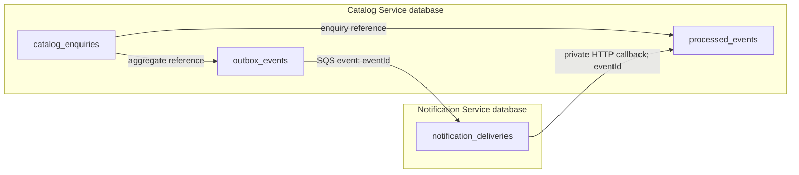

# Catalog Platform — Data Model

**Version:** 1.0  
**Status:** Approved logical design baseline; verify physical schema against implementation migrations  
**Project:** AI-Native Engineer Code Challenge for Catalog Platform
**Database:** PostgreSQL  
**Related documents:** `CLAUDE.md`, `SPEC.md`, `ASSUMPTIONS.md`, `DECISIONS.md`, `docs/api-contracts.md`, `docs/event-contracts.md`

---

## 1. Purpose and Design Rules

This document describes the logical persistence model for the two business services:

- **Catalog Service** owns enquiries, their business lifecycle, Outbox events and callback idempotency records.
- **Notification Service** owns email delivery outcomes and durable callback retry progress.

The two services must own separate databases and migrations. A single local PostgreSQL container may host separate logical databases for convenience, but each service must use separate credentials and must access only its own database.

The schema supports the approved event-driven workflow without introducing a separate product catalogue database or sharing tables between services.

### 1.1 Requirements versus schema recommendations

`SPEC.md` identifies the required logical records and provides suggested fields. This document turns those into a practical PostgreSQL design. Where a field, index, constraint or SQL fragment is described as **recommended**, it is a design recommendation rather than a separately mandated assessment requirement. The implemented migrations remain the source of truth for the physical schema and must be kept aligned with this document.

### 1.2 Non-negotiable ownership rules

1. Catalog Service is the only writer of `catalog_enquiries` and Catalog Service Outbox/idempotency records.
2. Notification Service is the only writer of its notification delivery records.
3. Notification Service must never read or modify Catalog Service database tables.
4. Catalog Service must never depend on Notification Service's database schema.
5. Do not use cross-service database joins or distributed transactions.
6. Changes that cross service boundaries use the SQS event or the private callback API, not direct database access.
7. Email-delivery and callback-retry status must not be added to `catalog_enquiries`.

---

## 2. Persistence Topology



The relationship between the two databases is a protocol relationship, not a database foreign key. `eventId` and `enquiryId` are carried in the event and callback contracts.

### 2.1 Catalog Service logical tables

| Table | Responsibility | Owner |
|---|---|---|
| `catalog_enquiries` | Enquiry data and authoritative business status | Catalog Service |
| `outbox_events` | Durable event record to publish to SQS | Catalog Service |
| `processed_events` | Callback event IDs already handled by Catalog Service | Catalog Service |

`processed_events` is the suggested physical name for the durable callback-idempotency mechanism. An equivalent implementation is acceptable only if it provides the same atomic duplicate protection.

### 2.2 Notification Service logical table

| Table | Responsibility | Owner |
|---|---|---|
| `notification_deliveries` | Email outcome, provider reference, callback progress and retry metadata | Notification Service |

The initial scope does not require a separate catalogue-products table. Fake Store API remains the initial product provider behind the Catalog Service provider abstraction. Persist the enquiry and a snapshot of the referenced product/category, not a duplicate full catalogue.

---

## 3. Catalog Service Schema

### 3.1 `catalog_enquiries`

**Purpose:** Persist a customer's enquiry and the only authoritative business lifecycle status.

| Column | Suggested PostgreSQL type | Nullability | Description |
|---|---|---:|---|
| `id` | `UUID` | NOT NULL | Primary key; enquiry ID returned by the public API. |
| `entity_type` | `TEXT` | NOT NULL | `PRODUCT` or `CATEGORY`. |
| `entity_id` | `TEXT` | NOT NULL | Identifier of the referenced product or category. |
| `entity_snapshot` | `JSONB` | NOT NULL | Relevant entity details captured at submission time, such as ID and display name. |
| `customer_name` | `TEXT` | NOT NULL | Customer name. |
| `customer_email` | `TEXT` | NOT NULL | Customer email address. |
| `customer_phone` | `TEXT` | NOT NULL | Customer phone number. |
| `message` | `TEXT` | NULL | Optional customer message. |
| `status` | `TEXT` | NOT NULL | One of `RECEIVED`, `PROCESSED`, `RESOLVED`. |
| `received_at` | `TIMESTAMPTZ` | NOT NULL | Time the enquiry was durably accepted. |
| `processed_at` | `TIMESTAMPTZ` | NULL | Time Catalog Service persisted `PROCESSED`. |
| `resolved_at` | `TIMESTAMPTZ` | NULL | Time the enquiry was explicitly resolved. |
| `resolved_by` | `TEXT` | NULL | Future sales actor/reference; no sales identity system is in the initial scope. |
| `resolution_notes` | `TEXT` | NULL | Optional future resolution notes. |
| `created_at` | `TIMESTAMPTZ` | NOT NULL | Record creation timestamp. |
| `updated_at` | `TIMESTAMPTZ` | NOT NULL | Last record update timestamp. |

**Required constraints and behaviour**

- Primary key on `id`.
- Check constraint restricting `entity_type` to `PRODUCT` or `CATEGORY`.
- Check constraint restricting `status` to `RECEIVED`, `PROCESSED` or `RESOLVED`.
- `entity_snapshot` must preserve enough context to identify what the customer enquired about at the time of submission.
- The initial status is always `RECEIVED`.
- `processed_at` and `resolved_at` are nullable until the corresponding transition is persisted.
- Do not store `email_status`, provider message ID, callback status or callback retry information in this table.
- Validate customer fields and entity references in the application layer as well as applying appropriate database constraints.

The table must not expose customer personal information in ordinary application logs. Any retention, deletion or privacy-erasure process must be considered in a deliberate data-retention policy; no retention period is specified in the assessment or current specification.

### 3.2 `outbox_events`

**Purpose:** Make enquiry persistence and event publication intent atomic. The Outbox row is committed in the same Catalog Service database transaction as the enquiry.

| Column | Suggested PostgreSQL type | Nullability | Description |
|---|---|---:|---|
| `id` | `UUID` | NOT NULL | Primary key and event ID; stable across publication retries. |
| `aggregate_type` | `TEXT` | NOT NULL | Aggregate/domain type, initially `ENQUIRY`. |
| `aggregate_id` | `UUID` | NOT NULL | Related enquiry ID. |
| `event_type` | `TEXT` | NOT NULL | Initially `CATALOG_ENQUIRY_SUBMITTED`. |
| `event_version` | `INTEGER` | NOT NULL | Event contract version; initially `1`. |
| `payload` | `JSONB` | NOT NULL | Complete, validated event envelope defined in `docs/event-contracts.md`. |
| `created_at` | `TIMESTAMPTZ` | NOT NULL | Time the Outbox event was created. |
| `published_at` | `TIMESTAMPTZ` | NULL | Set only after SQS confirms acceptance. |
| `claimed_by` | `TEXT` | NULL | Optional publisher identity/claim token for coordinating publishers. |
| `claim_expires_at` | `TIMESTAMPTZ` | NULL | Optional lease expiry so abandoned claims can be recovered. |
| `publish_attempt_count` | `INTEGER` | NOT NULL | Number of publication attempts; default zero. |
| `last_publish_error` | `TEXT` | NULL | Sanitized diagnostic information from the last failed publication attempt. |

**Required behaviour**

- `id` is the `eventId` in the event envelope and must not change when publication is retried.
- `aggregate_id` identifies the enquiry to which the event belongs.
- `published_at` remains `NULL` until SQS has accepted the message.
- A failed send must not mark the record as published.
- A crash after SQS accepts the event but before `published_at` is committed can cause duplicate publication. Consumer idempotency must handle this; exactly-once publication is not claimed.
- Use a safe claim/lease strategy when more than one publisher may run, so an active claim is not processed concurrently and abandoned claims can be recovered.
- Do not hold a database transaction open while waiting for a remote SQS request longer than necessary. Claim work, publish, then record the result using short, explicit transactions.

The exact claim strategy may use row locking such as `FOR UPDATE SKIP LOCKED` or another justified PostgreSQL-safe approach. The implementation must document how it handles a publisher crash and lease expiry.

### 3.3 `processed_events`

**Purpose:** Persist callback event IDs handled by Catalog Service so duplicate callback requests cannot apply a business transition more than once.

| Column | Suggested PostgreSQL type | Nullability | Description |
|---|---|---:|---|
| `event_id` | `UUID` | NOT NULL | Primary key; originating Outbox/SQS event ID. |
| `enquiry_id` | `UUID` | NOT NULL | Enquiry associated with the callback. |
| `callback_result` | `TEXT` | NOT NULL | `APPLIED` or `STALE_IGNORED` for the first handling of an event. |
| `processed_at` | `TIMESTAMPTZ` | NOT NULL | Time the callback outcome was durably recorded. |

**Required behaviour**

- Enforce uniqueness on `event_id`.
- Persist the idempotency record and enquiry transition in the same database transaction.
- A repeated callback with the same `event_id` returns the safe duplicate outcome and does not repeat the transition.
- If the enquiry is already `RESOLVED`, a stale callback must not regress it to `PROCESSED`. Record a safe stale outcome for the callback event and return `STALE_IGNORED`.
- A callback that cannot be safely applied because of a transient database/service failure must not be recorded as completed.

`DUPLICATE` is a response outcome for a repeated request, not a new stored first-processing outcome. The stored record can preserve the original outcome (`APPLIED` or `STALE_IGNORED`).

An optional foreign key from `processed_events.enquiry_id` to `catalog_enquiries.id` is recommended because both records are owned by Catalog Service. A foreign key from `processed_events.event_id` to `outbox_events.id` may be used if event retention policy and migration lifecycle make that relationship appropriate; it is not required by the logical contract.

### 3.4 Recommended Catalog Service indexes

| Index | Columns / predicate | Purpose |
|---|---|---|
| Primary key | `catalog_enquiries (id)` | Enquiry lookup and update. |
| Enquiry list/status | `(status, received_at DESC)` | Efficient status-scoped operational queries if/when needed. |
| Entity history | `(entity_type, entity_id, created_at DESC)` | Retrieve enquiry history for an entity if required. |
| Outbox pending work | Partial index on `(created_at)` where `published_at IS NULL` | Find unpublished events. |
| Outbox lease recovery | Index on `claim_expires_at` for claimed, unpublished records | Find expired publisher claims. |
| Callback idempotency | Primary key on `processed_events (event_id)` | Fast duplicate callback detection. |
| Callback enquiry lookup | `(enquiry_id, processed_at DESC)` | Find callback processing history for an enquiry if required. |

Only add indexes justified by query patterns. Validate index choices with actual SQL and query plans rather than adding every suggested index automatically.

---

## 4. Notification Service Schema

### 4.1 `notification_deliveries`

**Purpose:** Persist notification processing by the originating event ID, including the email provider outcome and independent Catalog callback progress. This table is owned exclusively by Notification Service.

| Column | Suggested PostgreSQL type | Nullability | Description |
|---|---|---:|---|
| `id` | `UUID` | NOT NULL | Primary key for the delivery ledger record. |
| `event_id` | `UUID` | NOT NULL | Unique event ID; the consumer idempotency key. |
| `enquiry_id` | `UUID` | NOT NULL | Catalog enquiry ID carried by the event; informational cross-service reference, not a cross-database foreign key. |
| `event_type` | `TEXT` | NOT NULL | Event type consumed, initially `CATALOG_ENQUIRY_SUBMITTED`. |
| `event_version` | `INTEGER` | NOT NULL | Event version validated by the consumer. |
| `email_status` | `TEXT` | NOT NULL | `PENDING`, `SENT` or `FAILED`. |
| `callback_status` | `TEXT` | NULL | `PENDING` or `COMPLETED`; `NULL` means no successful email exists yet to report. |
| `provider_message_id` | `TEXT` | NULL | Provider reference after successful acceptance. |
| `attempt_count` | `INTEGER` | NOT NULL | Number of email send attempts recorded. |
| `callback_attempt_count` | `INTEGER` | NOT NULL | Number of Catalog callback attempts recorded. |
| `last_email_attempt_at` | `TIMESTAMPTZ` | NULL | Time of the last email attempt. |
| `last_callback_attempt_at` | `TIMESTAMPTZ` | NULL | Time of the last callback attempt. |
| `email_sent_at` | `TIMESTAMPTZ` | NULL | Time successful provider acceptance was recorded. |
| `next_callback_retry_at` | `TIMESTAMPTZ` | NULL | Next eligible time for durable callback retry. |
| `callback_completed_at` | `TIMESTAMPTZ` | NULL | Time Catalog Service confirmed a safe callback outcome. |
| `last_email_error` | `TEXT` | NULL | Sanitized email failure detail; do not store secrets or full message content. |
| `last_callback_error` | `TEXT` | NULL | Sanitized callback failure detail. |
| `created_at` | `TIMESTAMPTZ` | NOT NULL | Ledger record creation time. |
| `updated_at` | `TIMESTAMPTZ` | NOT NULL | Last ledger update time. |

**Required constraints and behaviour**

- Primary key on `id`.
- Unique constraint on `event_id`.
- `email_status` is limited to `PENDING`, `SENT` or `FAILED`.
- `callback_status` is either `NULL`, `PENDING` or `COMPLETED` in the recommended representation. `NULL` indicates that successful email delivery has not yet been recorded and no success callback is pending.
- Attempt counters must be non-negative.
- A successful provider acceptance must be durably stored as `email_status = SENT` with the provider message ID before callback processing begins.
- Once `email_status = SENT`, callback failure or redelivery must not cause another email send.
- After successful email delivery, persist `callback_status = PENDING` before attempting the Catalog callback.
- Set `callback_status = COMPLETED` only after Catalog Service returns one of the safe outcomes `APPLIED`, `DUPLICATE` or `STALE_IGNORED`.
- Email and callback attempts/errors must remain separately observable. Do not use a single ambiguous retry counter or error field for both workflows.
- `enquiry_id` is a reference carried across service boundaries. Do not add a foreign key from this table to Catalog Service's database.

The `NULL` representation for a callback that has not yet become applicable is a recommended refinement of the two callback states defined in `SPEC.md` (`PENDING` and `COMPLETED`). It avoids presenting a callback as pending before any successful email exists. If the implementation instead uses a separate `NOT_STARTED` value, document that representation and keep the meaning of `PENDING` and `COMPLETED` unchanged.

### 4.2 Email retry and callback retry are separate

The source SQS queue's receive/redrive policy controls repeated processing after an email failure. `attempt_count` records those email attempts. A failed email leaves the Catalog enquiry in `RECEIVED` and does not create a successful Catalog callback.

Callback retries happen after a successful email has already been recorded. They are driven from the durable Notification Service ledger and must not depend on re-sending or re-consuming the email as a new send attempt.

Use `next_callback_retry_at` and `callback_attempt_count` for the callback retry worker. If an implementation adds separate persisted email retry scheduling, it must document how that interacts with SQS visibility and redrive rather than creating two competing retry authorities.

### 4.3 Recommended Notification Service indexes

| Index | Columns / predicate | Purpose |
|---|---|---|
| Primary key | `notification_deliveries (id)` | Ledger record lookup. |
| Event idempotency | Unique index on `(event_id)` | Find existing work and prevent duplicate ledger records. |
| Enquiry lookup | `(enquiry_id, created_at DESC)` | Inspect delivery state by enquiry where operationally needed. |
| Pending callbacks | Partial index on `(next_callback_retry_at)` where `callback_status = 'PENDING'` | Claim due callback retry work efficiently. |
| Oldest pending callbacks | `(created_at)` where callback is pending, if required | Operational visibility into callback backlog. |

A callback worker must safely claim due work so multiple worker instances do not concurrently send duplicate callback attempts unnecessarily. Use a short database transaction and a lease/claim mechanism if required by the deployment topology.

---

## 5. Key Relationships and Identity Rules

| Identifier | Generated/owned by | Used by | Meaning |
|---|---|---|---|
| `catalog_enquiries.id` / `enquiryId` | Catalog Service | Both services | Business enquiry identity. |
| `outbox_events.id` / `eventId` | Catalog Service | Catalog Service, SQS, Notification Service, callback | Unique identity of one event instance and idempotency key. |
| `notification_deliveries.id` | Notification Service | Notification Service only | Internal delivery ledger identity. |
| `provider_message_id` | Email provider | Notification Service | Provider's reference for the accepted email. |
| `correlationId` | API entry point or Catalog Service | Both services via event/callback metadata | Diagnostic trace across the workflow; not an authorization credential. |

The `eventId` must be stable across Outbox publication retries. Do not generate a new event ID each time the Outbox publisher sends the same logical event.

The `enquiryId` identifies the business record; it is not a replacement for `eventId`. Use `eventId` for message/callback idempotency.

---

## 6. Transaction Boundaries and State Changes

There is no distributed transaction spanning PostgreSQL, SQS, the email provider and both services. The design relies on local database transactions, durable hand-offs, idempotency and retry.

### 6.1 Enquiry acceptance (Catalog Service)

Within one Catalog Service database transaction:

1. Insert `catalog_enquiries` with status `RECEIVED`.
2. Create the versioned `CATALOG_ENQUIRY_SUBMITTED` envelope.
3. Insert its `outbox_events` row using the envelope's stable `eventId`.
4. Commit both records together.

Return `202 Accepted` only after commit. The response means the enquiry is durably received; it does not mean SQS has delivered the message or the email has been sent.

If validation or persistence fails before commit, roll back and return an appropriate error. Do not create an orphan enquiry without its corresponding Outbox event or an Outbox event without its enquiry.

### 6.2 Outbox publication (Catalog Service)

1. Claim committed rows where `published_at IS NULL` and no unexpired claim is held.
2. Publish the stored envelope to SQS using AWS SDK v3.
3. After SQS confirms acceptance, persist `published_at` and clear the active claim.
4. On failure, record a sanitized error/attempt and release or expire the claim for retry.

A process crash after SQS accepts the message but before the publication update can cause duplicate delivery. Keep the same event ID; Notification Service must deduplicate it.

### 6.3 Email processing (Notification Service)

1. Insert or locate the ledger row by unique `event_id`.
2. Validate the event and ensure only one active send attempt for that event is performed at a time, using safe database/worker coordination.
3. On provider failure, record `FAILED`, increment the attempt count and let the configured SQS retry/redrive policy decide whether the event is delivered again.
4. On provider acceptance, persist `SENT`, `provider_message_id`, `email_sent_at` and `callback_status = PENDING` durably.
5. Do not acknowledge the original SQS message until the email outcome and either callback completion or the durable pending callback retry state are recorded, consistent with `docs/event-contracts.md`.

There is an unavoidable uncertainty window if the email provider accepts a message but the Notification Service crashes before it persists the successful outcome. The system must not claim exactly-once email delivery. Document this residual failure mode and any provider-specific idempotency behaviour only when the selected provider actually supports it.

### 6.4 Catalog callback (Catalog Service)

Within one Catalog Service transaction:

1. Check whether `event_id` already exists in `processed_events`.
2. If it exists, return the safe duplicate result without reapplying the transition.
3. Lock or conditionally update the corresponding enquiry.
4. If status is `RECEIVED`, update it to `PROCESSED` and set `processed_at`.
5. If status is `RESOLVED`, leave it unchanged and record the callback as `STALE_IGNORED`.
6. Insert the `processed_events` record with the actual safe outcome.
7. Commit the status update and idempotency record together.

If the transaction fails, neither the idempotency record nor status transition may be partially committed. Return a retryable failure where appropriate so Notification Service retains the callback as pending.

### 6.5 Callback completion (Notification Service)

After Catalog Service returns `APPLIED`, `DUPLICATE` or `STALE_IGNORED`, Notification Service updates its own ledger to `callback_status = COMPLETED`, sets `callback_completed_at` and clears the next retry time. If the Catalog callback fails transiently, retain `PENDING`, update attempt/error metadata and calculate the next retry time. Do not send the email again.

### 6.6 Explicit resolution

`RESOLVED` represents a sales business action. Catalog Service performs the transition from `PROCESSED` to `RESOLVED` through its domain/service layer and persists `resolved_at` and any supported resolution metadata. A public unauthenticated status-update endpoint is out of scope. The full authenticated sales UI/workflow is deferred.

---

## 7. State Models

### 7.1 Catalog enquiry business status

```text
RECEIVED  --successful provider acceptance + persisted Catalog callback-->  PROCESSED
PROCESSED --explicit sales resolution------------------------------------->  RESOLVED
```

Email failure, SQS retry, DLQ placement, callback pending state or Notification Service restart do not change the Catalog enquiry status. The status remains `RECEIVED` until Catalog Service persists a valid callback outcome.

### 7.2 Notification email status

| State | Meaning |
|---|---|
| `PENDING` | No successful provider acceptance has been recorded yet. |
| `SENT` | Provider acceptance is known and durably recorded. |
| `FAILED` | A send attempt failed; queue retry/redrive policy may cause a later attempt. |

A later successful retry may move the recorded email state from `FAILED` to `SENT`. Once `SENT` is durably recorded, callback retry must not trigger another send.

### 7.3 Notification callback status

| Value | Meaning |
|---|---|
| `NULL` (recommended precondition) | No successful email has been recorded, so no success callback is pending. |
| `PENDING` | Email is recorded as `SENT`, but Catalog Service has not yet confirmed callback handling. |
| `COMPLETED` | Catalog Service has safely handled the callback. |

The recommended callback state is independent of email status. A row may be `email_status = SENT` and `callback_status = PENDING` while the Catalog enquiry remains `RECEIVED`.

---

## 8. Illustrative PostgreSQL DDL

The following SQL illustrates the logical design. It is not a migration file and must be reviewed against the actual repository conventions, naming, migration tooling and validated DTO constraints before use. `TEXT` is used for customer fields here so the physical database does not silently contradict request-length limits selected in the API validator; define those limits once and keep the API, OpenAPI, tests and migrations synchronized.

```sql
CREATE TABLE catalog_enquiries (
    id UUID PRIMARY KEY,
    entity_type TEXT NOT NULL CHECK (entity_type IN ('PRODUCT', 'CATEGORY')),
    entity_id TEXT NOT NULL,
    entity_snapshot JSONB NOT NULL,
    customer_name TEXT NOT NULL,
    customer_email TEXT NOT NULL,
    customer_phone TEXT NOT NULL,
    message TEXT,
    status TEXT NOT NULL CHECK (status IN ('RECEIVED', 'PROCESSED', 'RESOLVED')),
    received_at TIMESTAMPTZ NOT NULL DEFAULT now(),
    processed_at TIMESTAMPTZ,
    resolved_at TIMESTAMPTZ,
    resolved_by TEXT,
    resolution_notes TEXT,
    created_at TIMESTAMPTZ NOT NULL DEFAULT now(),
    updated_at TIMESTAMPTZ NOT NULL DEFAULT now()
);

CREATE INDEX idx_catalog_enquiries_status_received
    ON catalog_enquiries (status, received_at DESC);

CREATE INDEX idx_catalog_enquiries_entity_history
    ON catalog_enquiries (entity_type, entity_id, created_at DESC);

CREATE TABLE outbox_events (
    id UUID PRIMARY KEY,
    aggregate_type TEXT NOT NULL,
    aggregate_id UUID NOT NULL REFERENCES catalog_enquiries(id),
    event_type TEXT NOT NULL,
    event_version INTEGER NOT NULL CHECK (event_version > 0),
    payload JSONB NOT NULL,
    created_at TIMESTAMPTZ NOT NULL DEFAULT now(),
    published_at TIMESTAMPTZ,
    claimed_by TEXT,
    claim_expires_at TIMESTAMPTZ,
    publish_attempt_count INTEGER NOT NULL DEFAULT 0 CHECK (publish_attempt_count >= 0),
    last_publish_error TEXT
);

CREATE INDEX idx_outbox_events_unpublished
    ON outbox_events (created_at)
    WHERE published_at IS NULL;

CREATE INDEX idx_outbox_events_claim_expiry
    ON outbox_events (claim_expires_at)
    WHERE published_at IS NULL AND claim_expires_at IS NOT NULL;

CREATE TABLE processed_events (
    event_id UUID PRIMARY KEY,
    enquiry_id UUID NOT NULL REFERENCES catalog_enquiries(id),
    callback_result TEXT NOT NULL CHECK (callback_result IN ('APPLIED', 'STALE_IGNORED')),
    processed_at TIMESTAMPTZ NOT NULL DEFAULT now()
);

CREATE INDEX idx_processed_events_enquiry
    ON processed_events (enquiry_id, processed_at DESC);
```

Notification Service runs its own migration against its own database:

```sql
CREATE TABLE notification_deliveries (
    id UUID PRIMARY KEY,
    event_id UUID NOT NULL UNIQUE,
    enquiry_id UUID NOT NULL,
    event_type TEXT NOT NULL,
    event_version INTEGER NOT NULL CHECK (event_version > 0),
    email_status TEXT NOT NULL CHECK (email_status IN ('PENDING', 'SENT', 'FAILED')),
    callback_status TEXT CHECK (callback_status IN ('PENDING', 'COMPLETED')),
    provider_message_id TEXT,
    attempt_count INTEGER NOT NULL DEFAULT 0 CHECK (attempt_count >= 0),
    callback_attempt_count INTEGER NOT NULL DEFAULT 0 CHECK (callback_attempt_count >= 0),
    last_email_attempt_at TIMESTAMPTZ,
    last_callback_attempt_at TIMESTAMPTZ,
    email_sent_at TIMESTAMPTZ,
    next_callback_retry_at TIMESTAMPTZ,
    callback_completed_at TIMESTAMPTZ,
    last_email_error TEXT,
    last_callback_error TEXT,
    created_at TIMESTAMPTZ NOT NULL DEFAULT now(),
    updated_at TIMESTAMPTZ NOT NULL DEFAULT now()
);

CREATE INDEX idx_notification_deliveries_enquiry
    ON notification_deliveries (enquiry_id, created_at DESC);

CREATE INDEX idx_notification_deliveries_pending_callbacks
    ON notification_deliveries (next_callback_retry_at)
    WHERE callback_status = 'PENDING';
```

The illustrative `outbox_events.aggregate_id` and `processed_events.enquiry_id` foreign keys are local to Catalog Service's database. The Notification Service `enquiry_id` deliberately has no foreign key to Catalog Service.

---

## 9. Migrations and Deployment Rules

- Keep Catalog Service migrations separate from Notification Service migrations, even if both target one local PostgreSQL container.
- Use separate database names/credentials for the two services in local development.
- Commit all migration files to source control.
- Apply migrations as an explicit deployment/startup step controlled by the deployment workflow; do not rely on production application startup to create or mutate schemas implicitly.
- Make migrations repeatable through the migration tool's normal version tracking; do not hand-run untracked schema changes.
- Test both a clean database migration and an upgrade from the previous committed migration state where practical.
- Do not use a migration owned by one service to modify the other service's tables.
- Keep `.env.example` free of credentials and use only placeholder configuration values.

The actual database names, migration commands and environment variable names must be filled in `README.md` after repository implementation. Do not invent working command names before the migration tooling exists.

---

## 10. Privacy, Retention and Operational Notes

The Catalog enquiry and Outbox payload contain customer contact information; the event is sent through SQS and may also appear in diagnostic systems if handled carelessly.

- Restrict database and queue access to the service that owns the data or requires the event.
- Do not log full enquiry records, event payloads, email bodies, customer names, email addresses, phone numbers, credentials or provider secrets.
- Sanitize stored error messages before persisting them; omit request bodies and secrets.
- Use encrypted transport and the managed encryption controls available in the production environment.
- Avoid putting customer PII in metric labels or high-cardinality tracing attributes.
- Define record, Outbox, SQS and backup retention/deletion policies before production use. The assessment and current specification do not define a numeric retention period; do not invent one here.
- Consider how deletion/retention requirements apply to copies of customer data in Outbox payloads, queue messages, notification logs and backups.

---

## 11. Verification Checklist

This checklist is a design verification plan, not evidence that migrations or tests have already passed.

- [ ] Catalog Service and Notification Service use separate logical databases and credentials.
- [ ] Only Catalog Service can write `catalog_enquiries`.
- [ ] `catalog_enquiries.status` permits only `RECEIVED`, `PROCESSED` and `RESOLVED`.
- [ ] Enquiry and Outbox event commit or roll back together.
- [ ] The Outbox event ID remains stable through publication retries.
- [ ] A failed SQS send does not set `published_at`.
- [ ] Publisher claims recover safely after a process crash.
- [ ] Catalog callback idempotency record and enquiry transition commit atomically.
- [ ] Duplicate callback does not repeat the state transition.
- [ ] Stale callback does not regress a `RESOLVED` enquiry.
- [ ] Notification Service has a unique constraint on `event_id`.
- [ ] Email and callback status, attempts and errors are stored separately.
- [ ] Successful email acceptance is persisted before callback processing.
- [ ] Callback retry state survives Notification Service restart.
- [ ] Callback retry does not resend an email already recorded as `SENT`.
- [ ] Notification Service has no foreign key or query dependency on Catalog Service tables.
- [ ] No duplicate product catalogue tables have been added without an approved decision.
- [ ] Migrations are committed, service-owned and tested from a clean database.
- [ ] Sensitive data is not written to ordinary application logs.
- [ ] Physical migrations and this document agree on columns, constraints and indexes.

---

## 12. Change Control

If implementation requires a data-model change:

1. Check the original assessment, `SPEC.md` and the approved ownership rules.
2. Record genuine ambiguity in `ASSUMPTIONS.md`.
3. Record material changes to ownership, reliability or architecture in `DECISIONS.md`.
4. Update this document and the owning service's migration together.
5. Update repositories, DTO mappings and tests in the same implementation change.
6. Update `docs/api-contracts.md` or `docs/event-contracts.md` if the public API or event payload is affected.
7. Update `README.md` and `PR_DESCRIPTION.md` when setup, migrations or reviewer-visible behaviour changes.

Do not silently add cross-service database access, duplicate product persistence, email status to the enquiry table or callback progress to Catalog Service.
