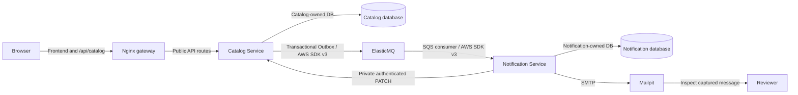

# Catalog Platform — Deployment Guide

**Version:** 1.0  
**Status:** Deployment baseline; local commands, ports and configuration must be verified against the implemented repository  
**Project:** AI-Native Engineer Code Challenge for Catalog Platform
**Related documents:** `README.md`, `CLAUDE.md`, `SPEC.md`, `PLAN.md`, `docs/architecture.md`, `docs/data-model.md`, `docs/api-contracts.md`, `docs/event-contracts.md`

---

## 1. Purpose and Scope

This document describes how to run the Catalog Platform locally and how the approved architecture maps to a future AWS deployment.

The initial assessment requires a complete local workflow that a reviewer can start in under 10 minutes, without an AWS account, AWS credentials, paid services or an external email account. The expected local environment uses Docker Compose, PostgreSQL, ElasticMQ and Mailpit.

Full production AWS provisioning is not part of the initial assessment. The AWS sections below define the deployment target and operational boundaries; they are not evidence that AWS resources have been provisioned.

**Implementation rule:** Before submission, verify every command, service name, environment variable, URL, exposed port and health endpoint against the actual repository. Replace any implementation-verification marker with confirmed details. Do not invent values or report an untested deployment as working.

## 2. Deployment Topologies

### 2.1 Local assessment environment

The local environment contains these components:

| Component | Responsibility | Local implementation |
|---|---|---|
| Browser application | Customer catalogue and enquiry experience | React + TypeScript static build |
| Public gateway | Serves the frontend and proxies `/api/*` requests | Nginx |
| Catalog Service | Catalogue APIs, enquiry persistence, lifecycle and Outbox publishing | Node.js + TypeScript + Express |
| Notification Service | SQS consumption, email delivery ledger and callback retries | Node.js + TypeScript worker |
| Catalog persistence | Enquiries, Outbox and processed callback event identities | PostgreSQL logical database owned by Catalog Service |
| Notification persistence | Email delivery and callback retry state | Separate PostgreSQL logical database owned by Notification Service |
| Message queue | Asynchronous enquiry event delivery | ElasticMQ, accessed using AWS SDK for JavaScript v3 |
| Email sink | Captures test notifications without sending real email | Mailpit SMTP and web UI |

The two business microservices retain separate data ownership even when one local PostgreSQL container hosts both logical databases. Use separate database credentials and migration ownership.

### 2.2 Network boundaries

- The browser reaches backend APIs only through the public gateway path `/api/catalog`.
- The browser must not call Catalog Service by an internal hostname or port.
- The browser must not call Notification Service.
- Notification Service consumes the SQS-compatible queue and calls Catalog Service's internal callback over private local service networking.
- The internal callback must not be routed through the public browser API surface.
- PostgreSQL and ElasticMQ must not be exposed publicly. Expose local diagnostic ports only when required by the reviewer workflow and document them accurately.

### 2.3 Local topology



This is a logical local topology. Confirm the actual Compose service names and network aliases from `compose.yaml` or `docker-compose.yml` after implementation.

---

## 3. Prerequisites

The reviewer should need only:

- A supported Docker installation with Docker Compose available.
- Git to clone the repository.
- A terminal capable of running the commands below.

Node.js and pnpm are required only if the repository supports or documents host-based development, test or build commands. The Docker-based reviewer flow should not require a locally installed database, queue, SMTP server or AWS CLI.

**Verify before submission:** Record the minimum supported Docker/Compose versions and any additional host tools actually required by the implemented scripts. Do not add unnecessary prerequisites.

## 4. Local Configuration

### 4.1 Environment file

The committed `.env.example` is the source of truth for local configuration names, required values and safe defaults.

From a clean checkout:

```bash
cp .env.example .env
```

Review the example file and change only values that the local environment requires. The default local workflow must not require AWS access keys, an AWS account, a paid service or a real email account.

### 4.2 Configuration categories

The final implementation must document the exact variable names and whether they are required. At minimum, review the following configuration categories against `.env.example`:

| Configuration area | Purpose | Local expectation |
|---|---|---|
| Runtime mode | Select local configuration and adapters | Local/development value |
| Public gateway | Frontend/API base path and gateway listener | Same-origin `/api/catalog` path |
| Catalog Service | HTTP listener, database connection and provider selection | Internal Compose networking |
| Notification Service | Worker settings, database connection and Catalog callback base URL | Internal Compose networking |
| PostgreSQL | Database names, credentials and connection settings | Local-only credentials; separate service identities |
| SQS-compatible queue | AWS region, endpoint override, queue URL/name and receive settings | ElasticMQ endpoint; no AWS credentials required |
| Email provider | Provider selection, SMTP host and port, sender and sales recipient | Mailpit/local SMTP; trusted server-side recipient configuration |
| Product provider | Initial provider selection and optional fixture mode | Fake Store API by default if network access is available; fixture provider for deterministic/offline tests |
| Correlation and logging | Log level and request correlation behaviour | Safe local defaults; no customer payload logging |

**Implementation verification required:** Populate this table with the exact environment variable names, defaults and required/optional status after inspecting the real configuration schema and `.env.example`. Remove any row that the implementation does not use. Do not create unused variables solely to match this guide.

### 4.3 Secrets and sensitive values

- Do not commit `.env` or any file containing credentials.
- Commit `.env.example` with placeholders or safe local values only.
- Do not place AWS credentials, SMTP passwords, database production credentials or provider secrets in source code, Docker images, event payloads or logs.
- Keep local-only credentials separate from production secrets.
- Do not print complete environment values when debugging; configuration output may expose secrets.

---

## 5. Start the Local Environment

### 5.1 Clone and enter the repository

```bash
git clone <repository-url>
cd <repository-directory>
```

Use the actual repository URL and directory name when sharing the final submission. Do not leave the angle-bracket placeholders in the final README if a repository URL is available.

### 5.2 Prepare local configuration

```bash
cp .env.example .env
```

### 5.3 Build and start the services

```bash
docker compose up --build
```

Run the command from the repository root. It should build and start the complete local workflow, including the frontend/gateway, both business services, PostgreSQL, ElasticMQ and Mailpit.

The expected reviewer flow should remain one or two commands after cloning. If the implementation requires a separate initialization command, explain why and keep the reviewer setup within the assessment's under-10-minute requirement.

**Verify after implementation:**

- Confirm the Compose file path and exact command.
- Confirm all services start without AWS credentials.
- Confirm both logical databases and their schemas are initialized/migrated.
- Confirm the required local SQS queue and DLQ configuration are initialized.
- Confirm the services become ready, not merely that containers are running.
- Confirm the frontend and Mailpit URLs and record their actual host ports.
- Confirm a clean checkout can start successfully within the reviewer time requirement.

### 5.4 Confirm service status

```bash
docker compose ps
```

A container in a `running` state is not necessarily ready to serve requests. Check the health status and logs of dependencies and application services. The Compose health checks and service readiness behaviour must reflect the dependencies each service actually requires.

### 5.5 Open local interfaces

Record the actual URLs and ports after inspecting the Compose port mappings:

| Interface | URL |
|---|---|
| Frontend and public API gateway | `VERIFY AFTER IMPLEMENTATION` |
| Mailpit web UI | `VERIFY AFTER IMPLEMENTATION` |
| Catalog Service health/readiness (local diagnostic only, if exposed) | `VERIFY AFTER IMPLEMENTATION` |
| Notification Service health/readiness (local diagnostic only, if exposed) | `VERIFY AFTER IMPLEMENTATION` |

The browser should use the same-origin API path `/api/catalog`. Do not ask the reviewer to call internal Catalog or Notification service hostnames directly to use the application.

### 5.6 Stop the environment

Stop and remove containers and the Compose network while retaining named volumes:

```bash
docker compose down
```

To restart later:

```bash
docker compose up --build
```

### 5.7 Reset local state (destructive)

To remove Compose-managed named volumes and reset local database/queue state:

```bash
docker compose down -v
```

**Warning:** This removes persisted local development data, including database contents. Do not use this command when you need to preserve local enquiries or diagnostic state.

---

## 6. Startup Dependencies and Readiness

Docker Compose startup order alone does not guarantee that a dependency is accepting connections. Use container health checks, bounded retries and explicit readiness handling rather than assuming that `depends_on` means the dependency is ready.

The logical startup dependencies are:

1. **PostgreSQL:** Accept connections and complete required initialization.
2. **Service databases:** Catalog and Notification logical databases exist; their own migration sets have completed successfully.
3. **ElasticMQ:** Accept SQS API requests; required queues and supported local redrive configuration are initialized.
4. **Mailpit:** SMTP listener is accepting local email connections.
5. **Catalog Service:** Database is ready; provider and SQS publisher configuration is valid. A temporary external product-provider outage should be surfaced as an application dependency failure, not hidden as an empty successful catalogue.
6. **Notification Service:** Its database, queue endpoint and SMTP provider are ready; its private Catalog callback base URL is configured.
7. **Nginx/frontend:** Static assets are available and public API proxy routing points to Catalog Service.

The exact health checks must be lightweight, bounded and appropriate for each component. Distinguish liveness (the process is running) from readiness (required dependencies are available) where needed. Avoid health-check loops that create cascading load or mark every component unhealthy because an unrelated optional dependency is temporarily unavailable.

Graceful shutdown must stop new work, finish or safely abandon in-flight work, preserve any durable callback retry state and avoid acknowledging SQS messages before their required outcomes are persisted.

---

## 7. Local Functional Smoke Test

After the environment is ready, perform this reviewer smoke test:

1. Open the frontend URL recorded in Section 5.5.
2. Confirm the homepage displays five backend-configured featured products.
3. Open a category and confirm top-rated and additional products are displayed without duplication.
4. Search for a product and confirm only matching products are returned.
5. Open a product details page.
6. Submit a valid product enquiry using test contact details.
7. Confirm that the customer receives a Thank You / received confirmation after Catalog Service has durably committed the enquiry and Outbox event.
8. Open the Mailpit web UI and confirm the corresponding sales notification is captured.
9. Verify through the implemented diagnostics or test evidence that the enquiry transitions from `RECEIVED` to `PROCESSED` only after Catalog Service persists the successful notification callback.
10. Confirm that the email provider's acceptance is not described as guaranteed inbox delivery.

Do not use real customer contact details in local testing. Do not claim any step passed until it has actually been run.

### 7.1 Critical failure-path checks

Where supported by the implemented test harness, verify:

- An email send failure leaves the Catalog enquiry in `RECEIVED` and follows the configured retry/DLQ policy.
- If email succeeds but the Catalog callback fails, the Notification Service persists callback state and retries the callback without sending the email again.
- A duplicate SQS event does not repeat a successfully recorded email delivery.
- A duplicate callback is idempotent.
- A callback does not regress a `RESOLVED` enquiry to `PROCESSED`.
- A Notification Service restart does not lose pending callback work.

Record exact commands and results in the test documentation and `PR_DESCRIPTION.md`.

---

## 8. Logs and Troubleshooting

### 8.1 Follow service logs

```bash
docker compose logs -f
```

To inspect a particular service, first list the actual Compose service names:

```bash
docker compose config --services
```

Then use the relevant service name:

```bash
docker compose logs -f <compose-service-name>
```

Do not paste logs containing customer personal information, credentials, tokens or full enquiry/email payloads into public issue trackers.

### 8.2 Common local issues

| Symptom | What to inspect | Safe next step |
|---|---|---|
| A container exits during startup | `docker compose ps`, service logs and configuration validation | Fix the reported configuration or startup error; do not repeatedly restart without reading logs. |
| Application starts before PostgreSQL is ready | PostgreSQL health status and application connection retry logs | Verify the health check and bounded dependency retry behaviour. |
| Database connection fails | Local database names, credentials, network aliases and migration logs | Compare the service-specific configuration with `.env.example`; do not expose credentials. |
| Queue not found or publisher fails | ElasticMQ health, queue initialization and configured queue URL | Verify the initialization step and SQS endpoint override. |
| Notification remains `RECEIVED` | Outbox publication, queue depth, consumer logs, email delivery ledger and DLQ | Trace by correlation ID, enquiry ID and event ID; do not manually change the business status. |
| Email is not visible in Mailpit | Notification worker status, SMTP host/port and provider configuration | Confirm the worker uses the Mailpit SMTP endpoint and that it recorded the send outcome. |
| Email appears but enquiry remains `RECEIVED` | Callback attempt state, private Catalog callback URL, authentication and Catalog logs | Allow the durable callback retry mechanism to recover; do not resend the email or edit the Catalog database directly. |
| Browser cannot reach APIs | Nginx status and `/api/catalog` proxy configuration | Check the gateway-to-Catalog route; browser code must not be changed to call internal service ports. |
| Product pages fail while the rest of the stack is healthy | Product provider reachability, timeout and fixture-provider configuration | Inspect the provider error; use the fixture-backed provider for deterministic/offline tests where supported. |
| Port already in use | Compose port mappings and local process using the port | Stop the conflicting process or change the documented local host mapping; update this guide with the actual value. |

### 8.3 Useful diagnostics

```bash
# Show service state and health.
docker compose ps

# List actual Compose service names.
docker compose config --services

# Follow all service logs.
docker compose logs -f

# Show the recent logs without following.
docker compose logs --tail=200
```

Avoid dumping fully rendered Compose configuration if it includes interpolated secrets. Inspect `.env.example` and the specific service configuration instead.

---

## 9. Local-to-AWS Service Mapping

The local environment is designed around AWS-compatible interfaces. The production target is:

| Local component / responsibility | AWS production target | Notes |
|---|---|---|
| React static build served by Nginx | Amazon S3 + Amazon CloudFront | CloudFront distributes static assets; API paths are routed separately. |
| Nginx public API proxy | Amazon API Gateway HTTP API | Public catalogue and enquiry routes go to Catalog Service. |
| Catalog Service container | Amazon ECS Fargate | Keep the service private behind the approved public API integration. |
| Notification Service worker | Amazon ECS Fargate | Private worker consuming SQS; not a public API service. |
| PostgreSQL container | Amazon RDS for PostgreSQL | Preserve Catalog/Notification data ownership, databases/schemas and credentials. |
| ElasticMQ | Amazon SQS Standard Queue | Use a production DLQ and configure redrive policy. |
| Mailpit | Amazon SES | Use the same email-provider abstraction; configure sender identity and permissions in AWS. |
| Local container images | Amazon ECR | Store versioned service images. |
| Local `.env` configuration | AWS Secrets Manager and task configuration | Use IAM task roles; do not bake secrets into images. |
| Container logs | Amazon CloudWatch | Centralize logs and operational metrics without customer payload leakage. |

ElasticMQ is an SQS-compatible local implementation, not a complete emulator of all AWS SQS behaviour. Local testing verifies the application integration with the subset used; it does not prove every AWS-managed service characteristic.

---

## 10. AWS Deployment Considerations (Future Target)

The following is a deployment outline, not an instruction to provision AWS resources during the initial assessment.

### 10.1 Network and service placement

- Place Catalog Service and Notification Service in private application subnets or an equivalently restricted runtime network.
- Expose the public API through API Gateway and the approved integration to Catalog Service.
- Keep Notification Service private; it should receive work from SQS and reach Catalog Service using private service-to-service connectivity.
- Do not expose PostgreSQL, SQS endpoints or internal callback endpoints directly to the internet.
- Configure security groups and network policies to allow only required service-to-service and managed-service traffic.

### 10.2 Identity and permissions

Use IAM task roles and least-privilege permissions. At minimum, review:

- Catalog Service permission to publish to the configured enquiry queue.
- Notification Service permission to receive, inspect and delete messages from the source queue and interact with its DLQ only as required by the operational design.
- Notification Service permission to send through SES.
- Service permission to retrieve only its required secrets/configuration from Secrets Manager.
- Database identities restricted to the owning service's database/schema and required operations.

Do not use long-lived AWS access keys in application configuration when task roles are available.

### 10.3 Database migrations

- Commit and version migrations separately for Catalog Service and Notification Service.
- Apply migrations as an explicit controlled deployment step, such as a one-off migration task or release pipeline action.
- Do not rely on every application replica to create or mutate production tables automatically at startup.
- Back up and verify database recovery procedures before production use.

### 10.4 Queue and email configuration

- Provision an SQS Standard Queue and associated DLQ with a deliberate redrive policy.
- Configure visibility timeout, receive count and retention based on measured processing behaviour; do not copy local values blindly.
- Configure queue encryption and access policies according to the environment's security requirements.
- Configure SES sender identity and sending permissions before enabling production notifications.
- Keep the success meaning precise: an accepted SES send request does not, by itself, guarantee inbox delivery.

### 10.5 Images and application rollout

A future release pipeline should:

1. Run tests, linting and TypeScript checks.
2. Build versioned Catalog and Notification container images.
3. Push images to ECR.
4. Apply database migrations in a controlled step.
5. Update ECS task definitions and services.
6. Verify health/readiness and critical service connectivity.
7. Publish the frontend build to S3 and invalidate/update CloudFront as appropriate.
8. Run smoke tests through the public API path and verify asynchronous notification processing.

Include rollback steps for application images and frontend assets. Database rollback must be designed migration-by-migration; do not assume every schema change can be reversed safely after data has been written.

### 10.6 Observability and operations

Use CloudWatch logs and metrics for:

- API availability and latency.
- Catalog Service errors and upstream product provider failures.
- Outbox backlog and oldest unpublished event age.
- SQS queue depth, oldest message age and DLQ depth.
- Notification processing success/failure counts.
- Pending callback count and oldest pending callback age.
- Circuit Breaker state and callback retry attempts.
- Database health and connection saturation.

Use correlation, event and enquiry IDs for traceability. Do not put customer names, email addresses, phone numbers or message contents into metric dimensions or routine logs.

Define alarms and an operational owner for DLQ messages and terminal callback failures before production use.

---

## 11. Deployment Security Checklist

- [ ] `.env` and production secret files are excluded from source control.
- [ ] `.env.example` contains safe placeholders and matches the real configuration schema.
- [ ] Local startup does not require AWS credentials or paid services.
- [ ] PostgreSQL and ElasticMQ are not publicly exposed by default.
- [ ] Catalog and Notification database identities are separate.
- [ ] Browser traffic reaches backend APIs only through the public gateway.
- [ ] Notification Service and its callback endpoint are not exposed through public gateway routing.
- [ ] Internal callback requires service-to-service authentication.
- [ ] Production services use least-privilege IAM task roles.
- [ ] Production secrets are managed outside source code and container images.
- [ ] Logs and metrics do not expose customer personal data or secrets.
- [ ] Queue retry, DLQ redrive and callback recovery have documented operational ownership.

## 12. Pre-Submission Verification Checklist

- [ ] The local environment starts from a clean checkout using the documented command(s).
- [ ] Reviewer setup completes in under 10 minutes.
- [ ] All Compose services report the expected health/readiness state.
- [ ] Both service-owned database migrations complete successfully.
- [ ] Required local queues are initialized and accessible.
- [ ] The frontend and Mailpit URLs are documented with actual ports.
- [ ] No AWS credentials, paid services or external email accounts are required for local review.
- [ ] The product provider's online and fixture/offline behaviour is documented accurately.
- [ ] The product enquiry happy path works end to end.
- [ ] Email failure and callback retry behaviour are verified.
- [ ] Public gateway routing does not expose Notification Service or the internal callback.
- [ ] README setup instructions and this deployment guide match the actual implementation.
- [ ] All verification claims are supported by executed commands or tests.

---

## 13. Change Control

When deployment behaviour changes:

1. Check the original assessment, `SPEC.md` and approved architecture.
2. Record an unspecified implementation assumption in `ASSUMPTIONS.md`.
3. Record a material architecture or deployment decision in `DECISIONS.md`.
4. Update this guide, `README.md` and the Compose/configuration documentation together.
5. Update health checks, tests and operational instructions in the same change.
6. Do not describe a future AWS target as a deployed environment.

**Deployment principle:** The local setup must be easy for the reviewer to run; the production target must preserve the same service ownership, asynchronous reliability and security boundaries without pretending that local emulators are identical to AWS-managed services.
