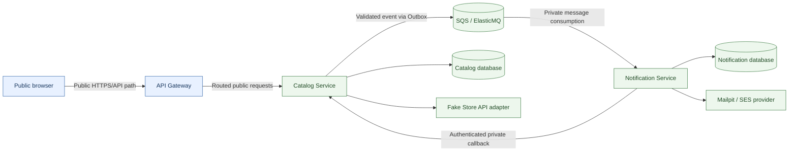

# Catalog Platform — Security Design

**Version:** 1.0  
**Status:** Approved security baseline; verify controls against the implementation  
**Project:** AI-Native Engineer Code Challenge for Catalog Platform
**Related documents:** `CLAUDE.md`, `SPEC.md`, `ASSUMPTIONS.md`, `DECISIONS.md`, `docs/api-contracts.md`, `docs/event-contracts.md`, `docs/data-model.md`, `docs/deployment.md`

---

## 1. Purpose and Security Objectives

This document consolidates the security requirements for the product catalogue and enquiry workflow. It defines the trust boundaries, minimum controls, sensitive data handling rules and security verification expected before submission.

The initial application is a public catalogue with public enquiry submission and private asynchronous notification processing. It does not include customer accounts, a sales dashboard or a public enquiry-status management API.

Security objectives:

1. Keep internal services, databases, queues and operational interfaces inaccessible to public browsers.
2. Validate and safely handle all data crossing an application or service boundary.
3. Protect customer contact information and enquiry content.
4. Prevent customer input from controlling privileged actions, notification recipients or provider configuration.
5. Keep secrets out of source control, logs, API responses and event payloads.
6. Preserve service-owned data boundaries and the integrity of the enquiry lifecycle.
7. Make security controls testable without requiring a paid service or an AWS account for local review.

This is an implementation security baseline, not a claim that the controls have already been implemented or independently audited.

## 2. Scope and Security Boundaries

### 2.1 Public-facing surface

The following capabilities are intentionally public in the initial assessment:

- Homepage and catalogue browsing.
- Category browsing.
- Product search and product details.
- Product enquiry submission.
- Category enquiry submission, as an approved extension using the same enquiry workflow.

Public API requests enter through the API Gateway path. The browser must not call Catalog Service by an internal hostname or port, call Notification Service, call Fake Store API directly, or communicate with PostgreSQL or SQS.

### 2.2 Private service surface

The following components and operations are private:

- Catalog Service internal callback endpoint.
- Notification Service worker and callback retry processing.
- PostgreSQL databases and database ports.
- SQS / ElasticMQ endpoints and queue administration.
- Internal health, readiness and operational interfaces where they expose dependency or environment details.

Notification Service may call the Catalog Service notification-status callback only through private service-to-service connectivity and an authenticated service identity.

### 2.3 Trust-boundary diagram

The diagram describes logical trust boundaries. It does not imply that the local environment provides the same network isolation as a production VPC.

## 3. Identity, Authentication and Authorization

### 3.1 Customer access

The initial assessment does not require customer accounts or customer authentication. Catalogue reads and enquiry creation are public capabilities.

Do not introduce a general customer login system or sales administration UI as part of this scope.

Public access does not mean unrestricted access. Enquiry submission must be validated and rate-limited, and all internal operations must remain protected.

### 3.2 Service-to-service authentication

The Notification Service callback to Catalog Service must:

- Use private service-to-service connectivity.
- Authenticate the calling service using an explicit service identity mechanism.
- Authorize only the Notification Service identity to invoke the notification-status operation.
- Reject unauthenticated or unauthorized callers.
- Avoid treating `eventId`, `correlationId`, `enquiryId` or other caller-controlled payload fields as authentication credentials.

The exact mechanism must be selected and documented during implementation and deployment design. It must be usable in the local Docker environment without requiring a paid external account, and it must map to a secure production AWS deployment. Do not silently treat private networking alone as authentication.

The callback must not be exposed through the public API Gateway or served to the browser.

### 3.3 Authorization and lifecycle ownership

- Catalog Service is the only service allowed to write enquiry business status.
- Notification Service may report successful email processing through the authenticated callback; it does not directly update Catalog Service data.
- The public API supports enquiry creation, not arbitrary status mutation.
- Do not expose an unauthenticated public endpoint to mark an enquiry `RESOLVED`.
- The `RESOLVED` domain operation remains a business capability for a future authenticated sales workflow.

## 4. Input Validation and Data Handling

Validate all data at the boundary where it enters a service. TypeScript types alone are not runtime validation.

### 4.1 Public HTTP requests

Catalog Service must validate:

- Request body shape and content type.
- Required and optional fields.
- String lengths and whitespace-only values.
- Email address format.
- Product/category entity type and identifier.
- Path parameters and query parameters.
- JSON parsing and request body size.

For enquiry submission:

- Accept only `PRODUCT` and `CATEGORY` entity types.
- Require customer name, email and phone according to the API contract.
- Treat the message as optional.
- Validate that the referenced entity exists and is of the specified type.
- Store an entity snapshot for the accepted enquiry.
- Do not accept an email recipient, provider name, template path, lifecycle status or privileged routing instruction from customer input.

A malformed or invalid request must fail with the documented safe error response. Do not partially persist an enquiry.

### 4.2 Product provider responses

Fake Store API responses are untrusted external input. Catalog Service must validate and normalize them in the provider adapter before exposing them through the public API or using them in business logic.

- Validate required fields and expected data types.
- Validate and normalize identifiers.
- Validate image URLs and numeric price/rating values.
- Handle missing, malformed or unexpected upstream fields explicitly.
- Do not pass raw provider response objects through to React.
- Do not convert provider failures or malformed responses into misleading successful empty results.

### 4.3 SQS event input

Notification Service must validate every message before processing it, even when it was published by the internal Outbox publisher.

- Validate the event envelope, event type and supported version.
- Validate entity type and required customer fields.
- Reject unsupported event versions and malformed messages safely.
- Do not trust SQS message attributes as authorization data.
- Do not let payload values select arbitrary recipients, template file paths, SMTP hosts, AWS regions or provider credentials.

Follow the event validation and recovery behaviour in `docs/event-contracts.md`.

### 4.4 Internal callback input

Catalog Service must validate the callback caller's identity and the full request payload independently.

The callback must validate the enquiry ID, event ID, notification status, provider message ID and timestamp. It must apply only the documented idempotent transition and must never regress a `RESOLVED` enquiry.

## 5. API and Network Protection

### 5.1 Gateway and routing

- Serve the public frontend and public API through the documented entry point.
- Route only intended `/api/catalog/*` routes to Catalog Service.
- Keep Notification Service and its callback/retry interfaces private.
- Do not expose PostgreSQL, SQS, ElasticMQ, internal worker ports or database administration interfaces to the public network.
- Configure appropriate upstream timeouts and reject unsupported paths.
- Use HTTPS for production public traffic and secure private service communication according to the selected deployment topology.

### 5.2 CORS and browser security

- Prefer same-origin frontend/API routing through the local Nginx gateway and the production CloudFront/API Gateway path.
- Where cross-origin access is required, configure CORS with explicit allowed origins and required methods/headers.
- Do not use an unrestricted wildcard origin with credentialed requests.
- Apply appropriate security response headers at the serving layer.
- Avoid rendering customer-provided content as trusted HTML.

The precise header set and production values must be verified against the actual frontend hosting and API routing configuration.

### 5.3 Request limits and abuse prevention

- Apply request body size limits to public and internal APIs.
- Rate-limit public enquiry submission.
- Use conservative, configurable limits suitable for a small assessment application; document the selected values and the layer enforcing them.
- Return a consistent `429 Too Many Requests` response when the public enquiry limit is exceeded.
- Do not rely on client-side form validation as the abuse-prevention control.

The assessment does not prescribe a specific rate-limit algorithm, threshold, or storage backend. Choose a proportionate implementation without adding a new infrastructure dependency unless justified.

## 6. Database and Persistence Security

### 6.1 Service-owned credentials and data

- Catalog Service owns and accesses its own database objects.
- Notification Service owns and accesses its own database objects.
- Use separate logical databases and separate credentials in the local shared PostgreSQL container.
- Do not grant Notification Service direct access to Catalog Service tables.
- Do not grant Catalog Service access to Notification Service's private delivery ledger unless a separately approved requirement exists.
- Avoid cross-service database joins and shared write access.

### 6.2 Query safety

- Use parameterized SQL for all database queries.
- Do not concatenate untrusted input into SQL statements, identifiers or order clauses.
- Validate dynamic sort/filter inputs against explicit allow-lists when they are supported.
- Keep database operations behind service-owned repositories or data-access modules.

### 6.3 Database permissions and migrations

- Use least-privilege database accounts for each service.
- Use separate migration paths and credentials.
- Do not run application processes with broad database-owner permissions where a narrower role is practical.
- Commit schema migrations; do not depend on implicit production schema creation during application startup.
- Keep database ports private in production and bind local development ports only as required for development/reviewer access.

### 6.4 Sensitive fields and retention

Enquiry records, Outbox payloads and notification delivery records can contain customer contact information and message content. Treat them as sensitive application data.

The approved design does not establish a specific retention period. Do not invent one in this document or in implementation. Define retention and deletion behaviour only through an explicit policy/decision, and ensure any later policy covers both service databases and queued/dead-letter messages.

## 7. Secrets and Configuration

### 7.1 Local development

- Commit `.env.example` with variable names and safe placeholders only.
- Keep actual `.env` files out of source control.
- Do not put real passwords, API keys, SMTP credentials, tokens or production connection strings in examples, tests, fixtures, screenshots or documentation.
- Use local-only credentials for Docker dependencies and clearly distinguish them from production secrets.
- Do not print secret values in startup logs or diagnostic commands.

### 7.2 Production AWS

- Use IAM task roles for AWS service access rather than static access keys in application configuration.
- Use AWS Secrets Manager or the approved secret-management facility for secrets that cannot be supplied through IAM roles.
- Grant least-privilege IAM permissions to each service role.
- Keep queue, database and email-provider permissions scoped to the operations each service requires.
- Do not include credentials or secrets in SQS event bodies, Outbox payloads, logs or application responses.

### 7.3 Secret exposure checks

Before pushing a branch:

- Inspect the staged diff and full repository changes for secrets.
- Confirm `.env` and local runtime files are ignored.
- Confirm `.env.example` contains no real values.
- Check logs and test snapshots for tokens, passwords and provider credentials.
- Remove accidental secrets from the working tree and rotate any credential that was exposed; deleting it from the latest commit alone may not remove it from Git history.

## 8. Customer Privacy, Logging and Observability

### 8.1 Data minimization

Use customer personal information only for the enquiry and sales notification workflow. Do not add unnecessary fields to the public request, event payload, logs or analytics.

The event must contain only the customer and entity information needed by Notification Service. Keep secrets and provider configuration outside the event.

### 8.2 Logging rules

Use structured logs with useful operational identifiers, such as:

- `correlationId`.
- `enquiryId`.
- `eventId`.
- Notification delivery record ID.
- Service name and operation.
- Attempt number and processing duration.
- Sanitized error category/code.

Do not log:

- Full enquiry or SQS event payloads.
- Customer name, email address, phone number or message content in normal application logs.
- Full email content or rendered templates.
- Passwords, access tokens, API keys, SMTP credentials or AWS secrets.
- Raw database errors or unredacted provider responses if they may contain sensitive information.

Do not place personal information in metrics labels, trace attributes or high-cardinality telemetry. Sanitize error details before storing them in the notification delivery ledger.

### 8.3 Error responses

- Use the common API error envelope in `docs/api-contracts.md`.
- Return safe validation details without echoing sensitive input values.
- Do not expose stack traces, SQL statements, database hostnames, internal service addresses, queue URLs, credentials or provider internals.
- Include the request/correlation identifier where available.
- Keep technical diagnostics in access-controlled, appropriately redacted logs.

### 8.4 Correlation identifiers

Propagate the effective correlation ID across public request handling, the Outbox event, SQS message, Notification Service processing and the private callback.

A correlation ID is diagnostic metadata only. It must never grant access or prove a service identity.

## 9. Email and Notification Security

- Resolve sales recipients exclusively from trusted backend configuration.
- Do not accept arbitrary `to`, `cc`, `bcc`, sender, reply-to or provider settings from the customer.
- Select PRODUCT and CATEGORY templates from a fixed server-side mapping.
- Keep template rendering separate from SMTP/SES transport.
- Escape customer-provided text before inserting it into HTML email content.
- Provide a plain-text alternative.
- Do not interpret customer messages as executable template syntax or markup.
- Keep provider credentials outside source code and event payloads.
- Treat a provider message ID as diagnostic data, not an authorization token.
- Do not claim inbox delivery solely from provider acceptance.

Mailpit is the local email-capture tool; it must not be treated as a production mail relay. Production email delivery targets Amazon SES through the approved provider abstraction.

## 10. Messaging and Worker Security

- Keep SQS and ElasticMQ endpoints private to the services that need them.
- Grant Catalog Service only the queue operations needed to publish events.
- Grant Notification Service only the queue operations needed to consume and acknowledge messages.
- Use IAM task roles in AWS, scoped to the required queue resources and actions.
- Validate every message body before processing.
- Do not execute code, template paths, SQL or provider configuration based on untrusted message content.
- Do not log full message bodies.
- Preserve the idempotency and durable callback recovery rules in `docs/event-contracts.md`.
- Keep dead-letter queues inspectable but restricted to authorized operators; no public DLQ management API is required.

## 11. Security-Relevant Failure Behaviour

| Failure or abuse case | Required behaviour |
|---|---|
| Malformed public request | Reject it with a safe validation response; do not persist a partial enquiry. |
| Invalid product/category reference | Reject the enquiry; do not create an Outbox event. |
| Oversized request body | Reject before business processing. |
| Enquiry rate limit exceeded | Return `429`; do not create the enquiry or Outbox event. |
| Product provider returns malformed data | Fail safely; do not expose unvalidated provider data. |
| Unauthenticated internal callback | Reject the request; do not change enquiry state. |
| Unauthorized service identity | Reject the request and record a safe security event without logging credentials. |
| Duplicate callback | Handle idempotently; do not repeat the transition. |
| Callback attempts to regress `RESOLVED` | Ignore safely according to the callback contract; keep `RESOLVED`. |
| SQL injection attempt | Parameterized queries and validation prevent input from changing query structure. |
| SQS message contains invalid/unsupported event data | Reject/quarantine through configured retry/DLQ handling; do not send email. |
| Customer input attempts to select recipient/template | Ignore or reject the unsupported fields; use server-side recipient/template configuration only. |
| Secret appears in configuration or logs | Do not expose it; remove from source/logs and rotate if it was actually exposed. |

## 12. Security Verification Checklist

This checklist is a verification plan. Do not mark a control complete until it has been inspected or tested.

### Public API and input validation

- [ ] All public request bodies, path parameters and query parameters are runtime-validated.
- [ ] Enquiry validation enforces the approved entity types and required contact fields.
- [ ] Referenced products/categories are validated before persistence.
- [ ] Empty, malformed and oversized input is rejected safely.
- [ ] Public enquiry submission is rate-limited and returns the documented `429` response.
- [ ] Customer input cannot choose notification recipients, templates or lifecycle status.
- [ ] Product provider responses are validated and normalized before use.

### Internal services and network

- [ ] Notification Service is not publicly reachable.
- [ ] The internal callback is not routed through the public API Gateway.
- [ ] The callback requires an authenticated Notification Service identity.
- [ ] Private networking and service authentication are both configured for production.
- [ ] Databases and queue endpoints are not exposed publicly.
- [ ] Public API requests use the API Gateway entry point only.

### Persistence and secrets

- [ ] All SQL uses parameterized queries.
- [ ] Service databases use separate credentials and ownership boundaries.
- [ ] `.env` and real secret files are excluded from Git.
- [ ] `.env.example` contains placeholders only.
- [ ] No secret is present in source, fixtures, screenshots, logs, events or API responses.
- [ ] AWS roles use least-privilege queue, database and provider permissions.

### Privacy and notifications

- [ ] Normal logs do not contain customer names, emails, phone numbers or enquiry messages.
- [ ] Error responses do not expose stack traces or internal infrastructure details.
- [ ] Customer-controlled content is escaped in HTML email templates.
- [ ] Sales recipients and sender/provider settings come from trusted configuration.
- [ ] SQS messages and Outbox payloads are treated as sensitive data.
- [ ] Correlation IDs are not used as credentials.

### Automated security tests

- [ ] Validation tests cover malformed and unexpected inputs.
- [ ] Tests prove an unauthenticated caller cannot invoke the internal callback.
- [ ] Tests prove public callers cannot mutate enquiry lifecycle state.
- [ ] Tests cover recipient/template injection attempts.
- [ ] Tests cover duplicate/stale callback handling.
- [ ] Tests or static checks detect committed secrets where tooling is available.
- [ ] Security-related failures are logged without exposing sensitive values.

## 13. Explicit Non-Goals and Open Implementation Choices

The following are not part of the initial assessment scope unless separately approved:

- Customer account authentication.
- Sales dashboard authentication or role management.
- Public enquiry-status administration.
- A full authorization framework for future sales operations.
- Full production AWS provisioning.
- A prescribed rate-limit algorithm or numerical threshold.
- A prescribed retention period.
- A prescribed service-authentication technology.

These items must not be silently invented as completed capabilities. The service-authentication mechanism, rate-limit values, production encryption configuration and operational retention policy must be recorded in implementation/deployment documentation when selected.

## 14. Change Control

When a security-relevant requirement or implementation choice changes:

1. Check the original assessment and `SPEC.md` before expanding scope.
2. Record genuine ambiguity in `ASSUMPTIONS.md`.
3. Record material security or architecture decisions in `DECISIONS.md`.
4. Update this document and affected API, event, data-model or deployment contracts together.
5. Update runtime validation, authorization checks and regression tests in the same implementation change.
6. Update `README.md` and `PR_DESCRIPTION.md` when the change affects reviewer configuration or visible behaviour.
7. Do not mark a security control verified without implementation evidence.

---

**Security completion rule:** The application is not ready for submission while public callers can reach internal services, customer input can influence privileged notification behaviour, secrets are exposed, or enquiry state can be changed outside Catalog Service's authenticated domain workflow.
